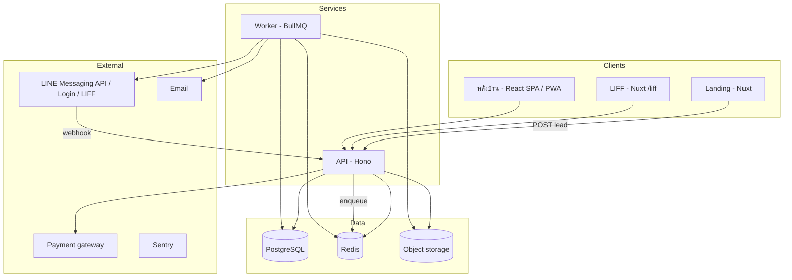

# 00 — ภาพรวมระบบ

> CoreUp เป็น **บริษัทที่ปรึกษา** ระบบนี้คือเครื่องมือที่ที่ปรึกษาใช้ทำงานและทิ้งไว้ให้ร้าน ฟีเจอร์ที่ดีคือฟีเจอร์ที่ (1) ช่วยที่ปรึกษาเห็นปัญหาและพิสูจน์ผล (2) ช่วยคนหน้างานทำงานน้อยลงจริง (3) ทำให้ร้านเดินได้โดยไม่ต้องพึ่งเจ้าของ

## 1. ระบบมีอะไรบ้าง

| ส่วน | ผู้ใช้ | หน้าที่ |
|---|---|---|
| **Landing page** (`apps/web`) | คนทั่วไป, เจ้าของร้านที่สนใจ | ขายบริการ CoreUp, บทความ, เคส, ฟอร์มนัดคุย → ส่ง lead เข้าระบบ |
| **LIFF** (`apps/web` route `/liff/*`) | ลูกค้าของร้าน (ผ่าน LINE) | ผูก LINE กับร้าน, ยืนยัน/เลื่อนนัด, จองคิว, แบบประเมินหลังรับบริการ |
| **หลังบ้านร้าน** (`apps/app`) | เจ้าของ, หัวหน้าสาขา, หน้าร้าน, พนักงาน | CRM นัด, กะ/เช็กลิสต์, SOP, แบบสอบถาม, แจ้งปัญหา, คิว/ค่ามือ, KPI |
| **Backoffice CoreUp** (`apps/app` สิทธิ์ `platform:*`) | ทีม CoreUp | จัดการร้านลูกค้า, แพ็กเกจ, ออดิท, รายงาน, CRM การขาย, template |
| **API** (`apps/api`) | ทุกส่วนข้างบน | REST `/v1`, webhook LINE, OpenAPI |
| **Worker** (`apps/worker`) | — | ส่งข้อความตามเวลา, คำนวณ KPI/คะแนน, สร้างรายงาน, import |

## 2. สถาปัตยกรรม



**หลักการไหลของข้อมูล**

1. Client เรียก API อย่างเดียว ไม่ต่อฐานข้อมูลตรง
2. API เขียนข้อมูล + เขียน **domain event** ลงตาราง `outbox_events` ใน transaction เดียวกัน
3. Worker อ่าน outbox → ทำงานต่อ (ส่ง LINE, คำนวณ, webhook ขาออก)
4. งานที่ต้องเกิดตามเวลา (เตือนนัด) เก็บใน `message_jobs` + BullMQ delayed job

## 3. หลักการออกแบบ (ต้องยึดทุกฟีเจอร์)

1. **Multi-tenant ตั้งแต่วันแรก** ทุกตารางข้อมูลร้านมี `tenant_id` + RLS
2. **Branch-aware** ข้อมูลที่ผูกกับหน้างานมี `branch_id` ร้านเดียวก็มี 1 branch เสมอ ไม่มีกรณีพิเศษ
3. **ห้าม hardcode ธุรกิจ** คำเรียก (คนไข้/ลูกค้า/แขก), ตำแหน่ง, บริการ, ข้อความ, เช็กลิสต์ มาจาก *industry template* และแก้ต่อร้านได้ (ดู 05)
4. **Module เปิด/ปิดได้** ทุกฟีเจอร์ใหญ่เป็นโมดูล (`crm`, `shifts`, `sop`, `surveys`, `reports`, `payouts`, `kpi`) เปิดตามแพ็กเกจ
5. **Permission-based** ตรวจสิทธิ์จาก permission string ไม่ใช่จากชื่อ role
6. **กติกาเป็นข้อมูล ไม่ใช่โค้ด** กติกาแบ่งคิว/ค่ามือ/จังหวะข้อความ เก็บเป็น JSON ที่มีเวอร์ชัน
7. **Channel abstraction** ส่งข้อความผ่าน interface กลาง LINE เป็น provider แรก
8. **ตรรกะธุรกิจอยู่ใน `packages/domain`** เป็นฟังก์ชันล้วน ไม่รู้จัก HTTP/DB → test ง่าย ย้ายภาษาได้
9. **Privacy by design** แบบสอบถามไม่ระบุตัวตนจริง เก็บข้อมูลเท่าที่จำเป็น ไม่เก็บข้อมูลการรักษา
10. **Schema เดียวใช้ทุกที่** Zod schema ใน `packages/schema` ใช้ทั้ง validate API, OpenAPI, ฟอร์มหน้าบ้าน

## 4. Tech stack

| ส่วน | เลือก | หมายเหตุ |
|---|---|---|
| ภาษา | TypeScript (strict) | ทุก app/package |
| Runtime | Node.js 22 LTS | ย้าย Bun ได้ภายหลัง |
| API framework | Hono + `@hono/zod-openapi` | สร้าง OpenAPI จาก Zod อัตโนมัติ |
| Validation | Zod | `packages/schema` |
| DB | PostgreSQL 16 | RLS, JSONB, partial index |
| ORM / migration | Drizzle ORM + drizzle-kit | migration เป็น SQL อ่านได้ |
| Queue | BullMQ + Redis | delayed job, retry, rate limit |
| Auth | Better Auth (session cookie) + LINE Login | ดู 02 §2 |
| Storage | S3-compatible (Cloudflare R2) | ไฟล์ SOP, รายงาน PDF, รูปเช็กลิสต์ |
| PDF | Playwright render HTML → PDF ใน worker | รายงานออดิท/KPI |
| หลังบ้าน | React 19, Vite, TanStack Router/Query/Table, Zustand, React Hook Form, shadcn/ui, Tailwind | SPA + PWA |
| Landing / LIFF | Nuxt (v3/v4), Nuxt Content, Tailwind, @nuxtjs/i18n, @nuxt/image | SSR/SSG |
| i18n | th (หลัก), en | key-based ทั้งสองฝั่ง |
| Monorepo | pnpm workspaces + Turborepo | |
| Lint/format | Biome | |
| Test | Vitest, Playwright | |
| Observability | Sentry, pino log, uptime check | |
| CI/CD | GitHub Actions → Railway auto-deploy | |
| Hosting | **Railway** (region Singapore): postgres, redis, api, worker, web, app | ดู 07-deploy-railway.md |

## 5. โครง repo

```
coreup/
├─ apps/
│  ├─ api/            # Hono: routes, middleware, webhook
│  ├─ worker/         # BullMQ processors, cron
│  ├─ app/            # React + Vite: หลังบ้านร้าน + backoffice CoreUp
│  └─ web/            # Nuxt: landing + /liff
├─ packages/
│  ├─ schema/         # Zod schema + type ร่วม (request/response/entity)
│  ├─ db/             # Drizzle schema, migrations, seed, RLS helpers
│  ├─ domain/         # ตรรกะล้วน: rules engine, คะแนน, KPI, รอบนัด, ค่ามือ
│  ├─ channels/       # interface ส่งข้อความ + provider LINE
│  ├─ templates/      # industry templates (clinic, spa, salon, restaurant, generic)
│  ├─ api-client/     # client generate จาก OpenAPI (openapi-typescript + openapi-fetch)
│  ├─ ui/             # design tokens, Tailwind preset (ใช้ร่วม app + web)
│  └─ config/         # tsconfig, biome
├─ infra/             # Dockerfile, docker-compose.dev.yml, IaC
└─ docs/              # เอกสารชุดนี้ + ADR
```

## 6. Environment

| env | ใช้ทำอะไร | ข้อมูล |
|---|---|---|
| `local` | docker compose: postgres, redis, minio, mailpit | seed ตัวอย่าง 3 ร้าน (คลินิก สปา ร้านสระผม) |
| `staging` | Railway env `staging` — ทดสอบ + ร้านนำร่องทดลอง | LINE OA ทดสอบแยก |
| `production` | Railway env `production` — ใช้งานจริง | สำรองรายวัน |

## 7. คำศัพท์โดเมน (ใช้ชื่อนี้ในโค้ดเท่านั้น)

| คำในโค้ด | ความหมาย | ตัวอย่างคำที่ร้านเห็น |
|---|---|---|
| `Tenant` | ธุรกิจลูกค้าของ CoreUp (1 เจ้าของ/1 บริษัท) | "ร้าน", "คลินิก" |
| `Branch` | สาขา | "สาขาสยาม" |
| `Member` | คนที่ล็อกอินได้ใน tenant (เจ้าของ พนักงาน) | "พนักงาน" |
| `Position` | ตำแหน่งงาน | "เทอราพิสต์", "ผู้ช่วยแพทย์", "ช่างสระ" |
| `Customer` | ลูกค้าของร้าน | "คนไข้", "ลูกค้า", "แขก" (มาจาก terminology) |
| `Service` | บริการที่ขาย | "หัตถการ", "คอร์สนวด", "สระไดร์" |
| `Package` | คอร์ส/แพ็กเกจหลายครั้ง | "คอร์ส 10 ครั้ง" |
| `Appointment` | นัดหมาย | "นัด", "คิว", "จอง" |
| `ServiceRecord` | บันทึกว่าใครให้บริการอะไรจริง | ใช้คิดค่ามือ |
| `FollowUp` | งานติดตามลูกค้า | "โทรตาม", "ถามอาการ" |
| `Shift` | กะงาน | "กะเช้า" |
| `Checklist` | รายการตรวจ | "เช็กลิสต์เปิดร้าน" |
| `Sop` | คู่มือสั้นต่องาน | "คู่มือ" |
| `Survey` | รอบแบบสอบถามพนักงาน | |
| `Report` | เรื่องที่พนักงานแจ้ง (ไม่ระบุชื่อ) | "แจ้งปัญหา" |
| `Audit` | การออดิทโดยทีม CoreUp | |
| `HealthScore` | คะแนนสุขภาพองค์กร 0–100 ต่อด้าน D1–D7 | |
| `Rule` | กติกาที่ร้านตั้ง (คิว ค่ามือ ข้อความ) | |
| `Lead` | ร้านที่ทีมขาย CoreUp กำลังคุย | |
