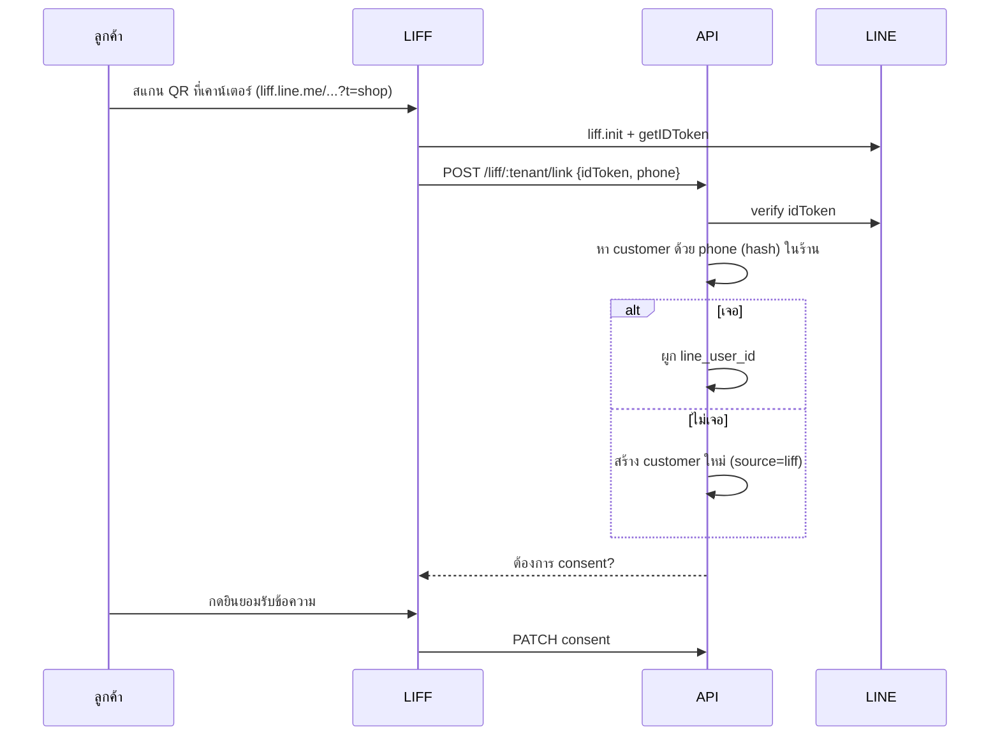

# 01 — Landing page + LIFF (Nuxt)

`apps/web` — Nuxt app เดียว มี 2 ส่วน

- **Landing**: เว็บขายของ CoreUp ที่ `coreup.xxx` (SSG/SSR, SEO สำคัญ)
- **LIFF**: หน้าเล็กที่เปิดในแอป LINE ที่ `liff.coreup.xxx` (client-only, ไม่ต้อง SEO)

แยกด้วย Nuxt route rules + โดเมน ถ้าโตขึ้นแยกเป็น 2 app ได้ เพราะใช้ `packages/ui` และ `packages/api-client` ร่วมกัน

---

## ส่วนที่ 1: Landing page

### 1.1 เป้าหมาย

งานเดียวของเว็บ: **ให้เจ้าของร้านกด "ตรวจร้านฟรี 30 นาที" หรือ "แอด LINE"** ทุก section พาไปที่ 2 ปุ่มนี้

จุดยืนบนเว็บ: **ที่ปรึกษา SME สายบริการ** (ไม่ใช่ขายโปรแกรม) · คำสัญญาหลัก "ภายใน 90 วัน คุณหยุดได้ 3 วัน โดยไม่ต้องโทรกลับร้าน" · เครื่องมือดึงความสนใจหลัก = **เครื่องคิดเงินรั่ว** (spec ที่ 13 §12) วางเป็น section ที่ 3 ต่อจากปัญหา และมีหน้าแยก `/leak-check`

ตัววัด (ตั้งเป็น conversion ใน GA4): `lead_submit`, `line_add_click`, `booking_click`

### 1.2 Stack

| ส่วน | ใช้ |
|---|---|
| Framework | Nuxt (ล่าสุดที่ stable) |
| เนื้อหา | Nuxt Content (Markdown/YAML ใน `content/`) |
| Style | Tailwind + preset จาก `packages/ui` (สีแบรนด์ Navy `#0B2D4F`, Gold `#D4B483`, Ivory `#F8F5ED`, Taupe `#C9B8A5`) |
| ฟอนต์ | Noto Sans Thai / IBM Plex Sans Thai (ไทย), Jost (โลโก้/ตัวเลข) ผ่าน `@nuxt/fonts` |
| รูป | `@nuxt/image` (webp/avif, lazy) |
| SEO | `@nuxtjs/seo` (sitemap, robots, og-image, schema.org) |
| i18n | `@nuxtjs/i18n` — `th` default, `en` เตรียมไว้ (prefix `/en`) |
| ฟอร์มกันสแปม | Cloudflare Turnstile |
| Analytics | GA4 + Meta Pixel โหลดหลังได้ consent |
| Deploy | Cloudflare Pages / Vercel |

### 1.3 Sitemap

| Path | ประเภท | เนื้อหา |
|---|---|---|
| `/` | SSG | หน้าหลัก |
| `/platform` | SSG | ระบบหลังบ้าน: ฟีเจอร์ตามโมดูล ภาพหน้าจอ |
| `/pricing` | SSG | แพ็กเกจที่ปรึกษา + แพ็กเกจระบบ (อ่านจาก content ไม่ hardcode) |
| `/industries` | SSG | รายการธุรกิจที่รองรับ |
| `/industries/[slug]` | SSG | หน้าแยกธุรกิจ: clinic, dental, spa, massage, salon, restaurant … (generate จาก `content/industries/*.yml`) |
| `/how-we-work` | SSG | 3 ขั้น: ออดิท → วางระบบ → วัดผล |
| `/cases` , `/cases/[slug]` | SSG | เคสก่อน–หลัง |
| `/articles` , `/articles/[slug]` | SSG | บทความ (Markdown) มี tag/หมวด |
| `/about` | SSG | ทีม ประสบการณ์หน้างาน |
| `/contact` | SSR | ฟอร์มนัดคุย + LINE + ช่องทางติดต่อ |
| `/privacy` , `/terms` | SSG | นโยบายความเป็นส่วนตัว / เงื่อนไข |
| `/demo` | SSG | (อนาคต) ขอทดลองใช้ระบบ |

**ขยายธุรกิจใหม่ = เพิ่มไฟล์ YAML 1 ไฟล์** ไม่ต้องเขียนหน้าใหม่

### 1.4 โครงหน้าหลัก `/`

| # | Section | Component | เนื้อหา |
|---|---|---|---|
| 1 | Header | `SiteHeader` | โลโก้, เมนู, ปุ่ม "นัดคุยฟรี" (sticky) |
| 2 | Hero | `HeroSection` | หัวข้อ, คำอธิบาย, 2 ปุ่ม, ภาพ dashboard ตัวอย่าง (ข้อมูลตัวอย่าง) |
| 3 | ปัญหา | `PainGrid` | 4–5 ปัญหาที่ร้านเจอ |
| 4 | เหมาะกับใคร | `FitSection` | ร้านเล็กคนไม่พอ / หลายสาขา |
| 5 | ธุรกิจที่รองรับ | `IndustryStrip` | การ์ดลิงก์ไป `/industries/[slug]` |
| 6 | วิธีทำงาน | `ProcessSteps` | 3 ขั้น |
| 7 | ระบบ | `PlatformPreview` | โมดูลหลัก + ตัวอย่างข้อความ LINE |
| 8 | ตัวเลขที่วัด | `KpiStrip` | KPI ที่ร้านจะเห็น |
| 9 | แพ็กเกจ | `PricingCards` | อ่านจาก `content/pricing.yml` |
| 10 | เคส | `CaseCarousel` | (ซ่อนถ้ายังไม่มีเคส) |
| 11 | FAQ | `FaqAccordion` | อ่านจาก `content/faq.yml` + ใส่ FAQPage schema |
| 12 | CTA | `LeadForm` | ฟอร์มสั้น + LINE |
| 13 | Footer | `SiteFooter` | ลิงก์, ติดต่อ, privacy |

### 1.5 Content model (`apps/web/content/`)

```
content/
├─ industries/
│  ├─ clinic.yml
│  ├─ spa.yml
│  └─ salon.yml
├─ cases/*.md
├─ articles/*.md
├─ pricing.yml
├─ faq.yml
└─ team.yml
```

ตัวอย่าง `industries/spa.yml`

```yaml
slug: spa
title: สปาและร้านนวด
headline: ให้ร้านนวดเดินได้ ไม่ต้องเฝ้าเองทุกวัน
templateKey: spa            # ตรงกับ packages/templates
order: 2
pains:
  - แย่งคิวและลูกค้าประจำ
  - ทิปและค่ามือไม่โปร่งใส
  - เทอราพิสต์ลาออกแล้วพาลูกค้าไป
firstSetup:
  - กติกาแบ่งคิว
  - ตารางเวร
  - เตือนรอบนวดผ่าน LINE
kpis: [no_show_rate, return_rate_90d, turnover_rate]
seo:
  title: ระบบหลังบ้านสปาและร้านนวด | CoreUp
  description: ...
```

`pricing.yml` ใช้ key เดียวกับ `plans.code` ใน DB เพื่อให้ราคาหน้าเว็บและระบบตรงกัน (sync ด้วยมือช่วงแรก ภายหลังดึงจาก `GET /v1/public/plans`)

### 1.6 Lead form

ฟิลด์

| field | type | required | หมายเหตุ |
|---|---|---|---|
| `contactName` | string | ✓ | |
| `businessName` | string | ✓ | |
| `industry` | enum จาก industries | ✓ | select |
| `branchCount` | enum `1`,`2-3`,`4+` | ✓ | |
| `staffCount` | enum `1-5`,`6-15`,`16-30`,`31+` | | |
| `province` | string | | |
| `phone` | string | หนึ่งใน phone/lineId | |
| `lineId` | string | | |
| `painPoints` | string[] | | checkbox จาก pains ของ industry |
| `message` | string | | |
| `consent` | boolean | ✓ | ยินยอมให้ติดต่อกลับ |
| `utm_*`, `referrer`, `landingPath` | hidden | | เก็บจาก query/cookie แรก |
| `turnstileToken` | hidden | ✓ | |

Flow

```
LeadForm → POST /v1/public/leads (Turnstile verify ฝั่ง API)
  → สร้าง lead (stage = new) ใน CRM การขาย
  → event lead.created → worker แจ้งกลุ่ม LINE ทีมขาย + อีเมล
  → หน้า /contact/thanks (ยิง conversion)
```

### 1.7 SEO / ประสิทธิภาพ / Accessibility

- ทุกหน้ามี title, description, canonical, og:image (สร้างอัตโนมัติจาก template)
- schema.org: `Organization`, `ProfessionalService`, `FAQPage`, `Article`, `BreadcrumbList`
- เป้า Lighthouse ≥ 90 ทุกหมวด, LCP < 2.5s บนมือถือ
- Contrast ผ่าน WCAG AA, ปุ่ม ≥ 44px, ใช้ได้ด้วยคีย์บอร์ด
- Cookie consent: ไม่โหลด GA4/Pixel จนกว่าผู้ใช้ยอมรับ

### 1.8 Component library (`apps/web/components`)

`SiteHeader`, `SiteFooter`, `Button`, `Section`, `HeroSection`, `PainGrid`, `FitSection`, `IndustryStrip`, `IndustryHero`, `ProcessSteps`, `PlatformPreview`, `LineChatMock`, `KpiStrip`, `PricingCards`, `CaseCard`, `CaseCarousel`, `FaqAccordion`, `LeadForm`, `ArticleCard`, `CookieConsent`

---

## ส่วนที่ 2: LIFF (หน้าใน LINE)

### 2.1 หลักการ

- เปิดจากปุ่มใน LINE OA ของร้าน (rich menu / flex message)
- ใช้ LIFF SDK `liff.init({ liffId })` → ได้ `idToken` → ส่งให้ API ยืนยันตัว
- **1 LIFF app ของ CoreUp ใช้ได้ทุกร้าน** ระบุร้านด้วย query `?t=<tenantSlug>` (หรือร้านใช้ LIFF ของตัวเองในอนาคต — รองรับไว้ใน `channel_accounts.liff_id`)
- ธีมสีหน้า LIFF ใช้สีและโลโก้ของ **ร้าน** (จาก `GET /v1/liff/:tenant/profile`) ไม่ใช่สี CoreUp
- คำเรียก (ลูกค้า/คนไข้) มาจาก terminology ของร้าน

### 2.2 หน้า LIFF

| Path | ทำอะไร | API |
|---|---|---|
| `/liff/link` | ผูก LINE กับลูกค้าของร้าน: กรอกเบอร์ → OTP/ยืนยัน → กดยินยอมรับข้อความ | `POST /v1/liff/:tenant/link` |
| `/liff/appointments` | นัดของฉัน (กำลังจะถึง/ที่ผ่านมา) | `GET /v1/liff/:tenant/me/appointments` |
| `/liff/appointments/:id` | ยืนยัน / ขอเลื่อน / ยกเลิก | `POST .../confirm` `.../reschedule-request` `.../cancel` |
| `/liff/book` | จองคิว (ถ้าร้านเปิด online booking) เลือกสาขา → บริการ → วัน/เวลา → (เลือกพนักงานถ้าร้านอนุญาต) | `GET .../availability` `POST .../appointments` |
| `/liff/packages` | คอร์ส/แพ็กเกจคงเหลือ วันหมดอายุ | `GET .../me/packages` |
| `/liff/feedback/:token` | ให้คะแนนหลังรับบริการ + ความเห็น → ถ้าคะแนนดี เสนอลิงก์รีวิว Google | `POST /v1/liff/feedback/:token` |
| `/liff/consent` | ดู/ถอนความยินยอมรับข้อความ | `PATCH .../me/consent` |
| `/s/:token` | (ไม่ต้องล็อกอิน LINE) แบบสอบถามพนักงานไม่ระบุชื่อ — เปิดได้ทั้งใน LINE และเบราว์เซอร์ | `GET/POST /v1/surveys/respond/:token` |
| `/r/new?t=` , `/r/:secret` | แจ้งปัญหาไม่ระบุชื่อ / ติดตามเรื่องด้วยรหัสลับ | `POST /v1/anon-reports` |

> แบบสอบถามและแจ้งปัญหา **ห้ามใช้ LINE Login** เพราะจะรู้ตัวตน ใช้ token แบบใช้ครั้งเดียวแทน (ดู 02 §7)

### 2.3 Flow ผูกลูกค้ากับ LINE


