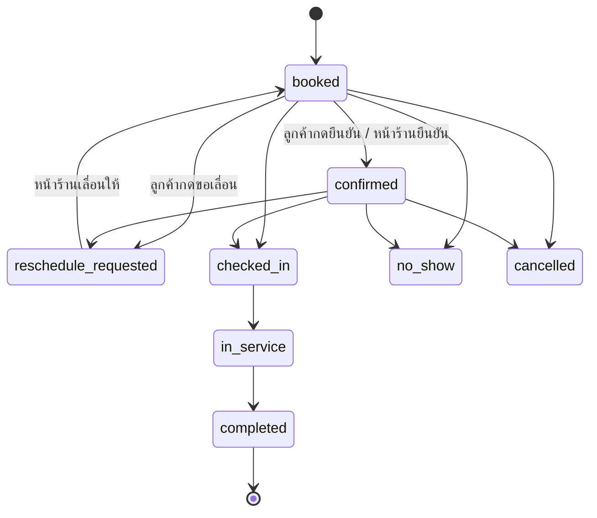

# 02 — API (`apps/api`)

REST + JSON, base `https://api.coreup.xxx/v1` · Hono บน Node 22 · Zod + OpenAPI (`/v1/openapi.json`, เอกสารที่ `/docs` เฉพาะ staging)

---

## 1. ข้อตกลงทั้งระบบ

### 1.1 รูปแบบทั่วไป

| เรื่อง | ข้อตกลง |
|---|---|
| ชื่อ field | `camelCase` ใน JSON, `snake_case` ใน DB (Drizzle map ให้) |
| ID | UUID v7 (เรียงตามเวลาได้) สร้างฝั่ง API |
| เวลา | ISO 8601 UTC (`2026-10-16T07:00:00Z`) แสดงผลตาม `tenant.timezone` (default `Asia/Bangkok`) |
| วันที่ล้วน | `YYYY-MM-DD` (เช่น วันเกิด, วันกะ) |
| เงิน | integer หน่วยย่อย (สตางค์) + `currency` ของ tenant (default `THB`) |
| เปอร์เซ็นต์ | basis points (1% = 100) ใน rule; ใน KPI response ใช้ number 0–100 ทศนิยม 1 ตำแหน่ง |
| ลบข้อมูล | soft delete (`deletedAt`) ยกเว้นคำขอลบตาม PDPA ที่ลบจริง/anonymize |
| ภาษา | header `Accept-Language: th|en` ใช้กับข้อความ error และ label จาก template |
| เวอร์ชัน | path `/v1` เปลี่ยนแบบ breaking = `/v2` ; เพิ่ม field ได้โดยไม่เพิ่มเวอร์ชัน |

### 1.2 Header

| Header | ใช้เมื่อ |
|---|---|
| `Cookie: cu_session=...` | หลังบ้าน (session cookie, HttpOnly, Secure, SameSite=Lax, domain `.coreup.xxx`) |
| `Authorization: Bearer <token>` | API key ของ integration ในอนาคต / LIFF session token |
| `X-Tenant-Id` | tenant ที่กำลังทำงาน (ผู้ใช้ 1 คนอยู่หลาย tenant ได้) |
| `X-Branch-Id` | สาขาปัจจุบัน (optional — ถ้าไม่ส่ง = ทุกสาขาที่มีสิทธิ์) |
| `Idempotency-Key` | **บังคับ** สำหรับ POST ที่สร้างนัด, บันทึกบริการ, ชำระเงิน, ส่งข้อความ (เก็บ 24 ชม.) |
| `X-Request-Id` | ถ้าไม่ส่ง API สร้างให้ และส่งกลับใน response ทุกครั้ง |

### 1.3 List / pagination / filter

```
GET /v1/customers?limit=50&cursor=eyJ...&sort=-createdAt&q=มายด์&filter[tag]=vip&filter[branchId]=...
```

Response

```json
{
  "data": [ ... ],
  "page": { "nextCursor": "eyJ...", "hasMore": true },
  "meta": { "total": 1240 }        // ส่งเฉพาะเมื่อ ?withTotal=true
}
```

- cursor-based ทุก list (`limit` สูงสุด 200, default 50)
- `sort` ใส่ `-` = มากไปน้อย, อนุญาตเฉพาะ field ที่ประกาศใน schema
- `filter[field]=value` ; ช่วง `filter[startAt][gte]=...`

### 1.4 Error

```json
{
  "error": {
    "code": "APPOINTMENT_SLOT_TAKEN",
    "message": "ช่วงเวลานี้มีนัดแล้ว",
    "details": { "field": "startAt" },
    "requestId": "01J..."
  }
}
```

| HTTP | code ตัวอย่าง |
|---|---|
| 400 | `VALIDATION_FAILED` (details = Zod issues) |
| 401 | `UNAUTHENTICATED` |
| 403 | `FORBIDDEN`, `MODULE_DISABLED`, `PLAN_LIMIT_REACHED` |
| 404 | `NOT_FOUND` |
| 409 | `CONFLICT`, `APPOINTMENT_SLOT_TAKEN`, `IDEMPOTENCY_IN_PROGRESS`, `VERSION_MISMATCH` |
| 422 | `RULE_INVALID`, `ANONYMITY_THRESHOLD` |
| 429 | `RATE_LIMITED` |
| 500 | `INTERNAL` |

รายการ code ทั้งหมดอยู่ใน `packages/schema/src/errors.ts` (enum เดียว ใช้ร่วมหน้าบ้านเพื่อแปลข้อความ)

### 1.5 Concurrency

ข้อมูลที่หลายคนแก้พร้อมกัน (นัด, กติกา, เวร) มี `version` integer → client ส่ง `If-Match: <version>` ตอน PATCH ถ้าไม่ตรงได้ 409 `VERSION_MISMATCH`

### 1.6 Rate limit (Redis sliding window)

| กลุ่ม | จำกัด |
|---|---|
| public (`/public/*`, `/liff/*`, `/surveys/respond/*`) | 30 req/นาที ต่อ IP |
| ผู้ใช้ล็อกอิน | 600 req/นาที ต่อ user |
| ต่อ tenant | 3,000 req/นาที |
| webhook LINE | ไม่จำกัด (ตรวจ signature) |

---

## 2. Authentication

### 2.1 ผู้ใช้หลังบ้าน (Member)

| วิธี | ใครใช้ | หมายเหตุ |
|---|---|---|
| อีเมล + รหัสผ่าน | เจ้าของ, ทีม CoreUp | Better Auth, รหัสผ่าน argon2id |
| LINE Login | พนักงาน | ไม่ต้องจำรหัส, ผูกกับ member ผ่านลิงก์เชิญ |
| Magic link (อีเมล) | สำรอง | |
| 2FA (TOTP) | บังคับสำหรับ role `platform_*` และ `owner` (เปิดใน M6) | |

Endpoints

| Method | Path | รายละเอียด |
|---|---|---|
| POST | `/v1/auth/sign-in/email` | `{email,password}` → set cookie |
| GET | `/v1/auth/line/start?invite=` | redirect ไป LINE Login |
| GET | `/v1/auth/line/callback` | สร้าง/ผูก user → set cookie → redirect `app.` |
| POST | `/v1/auth/sign-out` | |
| POST | `/v1/auth/password/forgot` `{email}` , `/v1/auth/password/reset` `{token,newPassword}` | ส่งลิงก์รีเซ็ตทางอีเมล (ตอบ 200 เสมอ ไม่เปิดเผยว่ามีอีเมลนี้หรือไม่) |
| POST | `/v1/auth/sign-up/email` `{name,email,password}` | สร้างบัญชี (ยังไม่มีสิทธิ์ร้านจนกว่าจะรับคำเชิญ) |
| POST | `/v1/auth/sign-in/magic-link` `{email}` | ส่งลิงก์เข้าสู่ระบบ (เฉพาะผู้ใช้ที่มีบัญชี) |
| GET | `/v1/me` | user + memberships (tenant, branches, roles, permissions, modules) |
| POST | `/v1/invites` | (สิทธิ์ `members:invite`) สร้างลิงก์เชิญ `{positionId, roleIds, branchIds, expiresInHours}` |
| GET | `/v1/invites/:token` | ข้อมูลคำเชิญ (public) |
| POST | `/v1/invites/:token/accept` | |

`GET /v1/me` response

```json
{
  "user": { "id": "...", "name": "แพร", "email": null, "lineLinked": true, "locale": "th" },
  "memberships": [{
    "tenant": { "id": "...", "name": "Mild Spa", "slug": "mild-spa", "industry": "spa",
                "timezone": "Asia/Bangkok", "currency": "THB", "logoUrl": "..." },
    "memberId": "...",
    "roles": ["front_desk"],
    "permissions": ["appointments:read", "appointments:write", "customers:read", "..."],
    "branchIds": ["..."],                       // [] = ทุกสาขา
    "modules": ["crm", "shifts", "sop", "surveys"],
    "terminology": { "customer": "ลูกค้า", "service": "บริการ", "appointment": "คิว" }
  }]
}
```

### 2.2 LIFF (ลูกค้าของร้าน)

`POST /v1/liff/:tenantSlug/session` `{ idToken }` → API verify กับ LINE (`https://api.line.me/oauth2/v2.1/verify`) → คืน `liffToken` (JWT อายุ 1 ชม., claim: `tenantId`, `customerId|null`, `lineUserId`) ใช้เป็น Bearer

### 2.3 Platform (ทีม CoreUp)

ทีม CoreUp เป็น user ที่มี membership ใน tenant พิเศษ `coreup` + role `platform_admin|platform_consultant|platform_sales`

- เข้าดูร้านลูกค้า: `POST /v1/platform/tenants/:id/impersonate` → ได้ session ชั่วคราว 60 นาที, ต้องกรอกเหตุผล, บันทึก `audit_logs` และแสดงแถบ "กำลังดูในฐานะทีม CoreUp" ในหน้าบ้าน
- ที่ปรึกษาเห็นเฉพาะ tenant ที่ถูก assign (`platform_assignments`)

---

## 3. Multi-tenancy (ต้องทำให้ถูกตั้งแต่ commit แรก)

Middleware ลำดับ

```
requestId → logger → cors → rateLimit → session → tenantResolver → branchScope → permission(route) → moduleGuard(route) → handler
```

1. `tenantResolver`: อ่าน `X-Tenant-Id` → ตรวจว่า user มี membership → ใส่ `c.var.tenant`, `c.var.member`
2. ทุก handler ใช้ `withTenantTx(c, async (tx) => ...)`

```ts
// packages/db/src/tenant-tx.ts
export async function withTenantTx<T>(ctx: TenantCtx, fn: (tx: Tx) => Promise<T>) {
  return db.transaction(async (tx) => {
    await tx.execute(sql`select set_config('app.tenant_id', ${ctx.tenantId}, true)`);
    await tx.execute(sql`select set_config('app.member_id', ${ctx.memberId ?? ''}, true)`);
    return fn(tx);
  });
}
```

3. Postgres RLS ใช้ `current_setting('app.tenant_id')` (ดู 03 §4) — **API ต้องต่อ DB ด้วย role `coreup_app` ที่ไม่ใช่ superuser** ไม่งั้น RLS ไม่ทำงาน
4. `branchScope`: ถ้า member จำกัดสาขา ทุก query ที่มี `branch_id` ต้อง `in (allowedBranchIds)` — ทำผ่าน helper `scopeBranch(table)` ไม่เขียนเองทุกที่
5. Test บังคับ: `tests/tenancy.spec.ts` สร้าง 2 tenant แล้วยิงทุก route ด้วย tenant A ขอ id ของ B ต้องได้ 404

---

## 4. Permissions (RBAC)

### 4.1 รูปแบบ

`<resource>:<action>` เช่น `appointments:write`, action มาตรฐาน `read | write | delete | manage` (`manage` = ทั้งหมด + ตั้งค่า)

Route ประกาศสิทธิ์แบบนี้

```ts
app.openapi(route({ method: 'post', path: '/appointments', permission: 'appointments:write', module: 'crm', ... }), handler)
```

### 4.2 รายการ permission

| Resource | read | write | delete | manage | โมดูล |
|---|---|---|---|---|---|
| `tenant` | ✓ | ✓ (ตั้งค่าร้าน) | | ✓ (แพ็กเกจ, ลบร้าน) | core |
| `branches` | ✓ | ✓ | ✓ | | core |
| `members` | ✓ | ✓ | ✓ | `members:invite` | core |
| `roles` | ✓ | ✓ | ✓ | | core |
| `positions` | ✓ | ✓ | ✓ | | core |
| `customers` | ✓ | ✓ | ✓ | `customers:export`, `customers:erase` | crm |
| `services` | ✓ | ✓ | ✓ | | crm |
| `packages` | ✓ | ✓ | ✓ | | crm |
| `appointments` | ✓ / `appointments:read:own` | ✓ | ✓ | | crm |
| `followups` | ✓ / `:own` | ✓ | | | crm |
| `messages` | ✓ | `messages:send` | | `messages:templates` | crm |
| `shifts` | ✓ / `:own` | ✓ | ✓ | | shifts |
| `checklists` | ✓ | `checklists:run` | | `checklists:manage` | shifts |
| `sops` | ✓ | ✓ | ✓ | | sop |
| `surveys` | `surveys:results` | ✓ | | | surveys |
| `anon_reports` | ✓ | `anon_reports:handle` | | | reports |
| `service_records` | ✓ / `:own` | ✓ | ✓ | | payouts |
| `rules` | ✓ | ✓ | | | payouts / crm |
| `payouts` | ✓ / `:own` | `payouts:close` | | | payouts |
| `kpi` | ✓ | | | `kpi:export` | kpi |
| `audit_logs` | ✓ | | | | core |
| `platform:*` | — | — | — | เฉพาะทีม CoreUp | platform |

### 4.3 Role สำเร็จรูป (seed จาก template, ร้านแก้/สร้างเพิ่มได้)

| role | permission โดยย่อ |
|---|---|
| `owner` | ทั้งหมดใน tenant |
| `branch_manager` | ทุกอย่างในสาขาตัวเอง ยกเว้น `tenant:manage`, `roles:*` |
| `front_desk` | customers, appointments, followups, messages:send, checklists:run, service_records:write |
| `practitioner` | appointments:read:own, followups:own, shifts:read:own, checklists:run, sops:read, service_records:read:own, payouts:read:own |
| `staff` | shifts:read:own, checklists:run, sops:read |
| `platform_owner` / `platform_admin` / `platform_consultant` / `platform_sales` | `platform:*` ตามหน้าที่ — รายละเอียดและขอบเขตการเห็นข้อมูลดู [09-roles-and-platform.md](09-roles-and-platform.md) |

> ทุก member ตอบแบบสอบถามและแจ้งปัญหาได้เสมอ (ไม่ต้องมีสิทธิ์ เพราะใช้ token ไม่ระบุตัว)

---

## 5. Modules และ plan

- `tenant_modules` บอกว่าร้านเปิดโมดูลไหน (มาจาก plan + เปิดเพิ่มรายร้าน)
- `moduleGuard` คืน 403 `MODULE_DISABLED`
- ขีดจำกัดของ plan (`plan_limits`): `branches`, `members`, `customers`, `messages_per_month` → เกินได้ 403 `PLAN_LIMIT_REACHED`

| Module key | ฟีเจอร์ |
|---|---|
| `core` | ร้าน สาขา สมาชิก ตำแหน่ง ตั้งค่า (เปิดเสมอ) |
| `crm` | ลูกค้า บริการ แพ็กเกจ นัด ติดตาม ข้อความ LIFF |
| `booking` | จองออนไลน์ผ่าน LIFF (ต้องมี crm) |
| `shifts` | กะ การ์ดหน้าที่ เช็กลิสต์ |
| `sop` | คู่มือ + ยืนยันการอ่าน |
| `surveys` | แบบสอบถามพนักงาน + คะแนนสุขภาพ |
| `reports` | แจ้งปัญหาไม่ระบุชื่อ |
| `payouts` | บันทึกบริการ กติกาคิว ค่ามือ ทิป |
| `kpi` | dashboard + export |
| `checkout` | บิล รับเงิน PromptPay QR ใบเสร็จ ลิ้นชักเงิน (POS-lite, ดู 11) |
| `audit` | เครื่องมือออดิท (ใช้โดยทีม CoreUp) |
| `ai` | (อนาคต) สรุป/วิเคราะห์ |

---

## 6. Endpoints ตามโมดูล

> ทุก path ด้านล่างอยู่ใต้ `/v1` และต้องมี `X-Tenant-Id` ยกเว้นกลุ่ม public/liff/webhook
> `[P]` = permission, `[M]` = module

### 6.1 Core — ร้าน สาขา คน

| Method | Path | [P] | รายละเอียด |
|---|---|---|---|
| GET | `/tenant` | tenant:read | ข้อมูลร้าน + settings + terminology |
| PATCH | `/tenant` | tenant:write | ชื่อ โลโก้ สี timezone เวลาเงียบ ค่า default |
| GET | `/tenant/terminology` · PUT | tenant:write | คำเรียก (ดู 05 §2) |
| GET | `/tenant/modules` | tenant:read | โมดูลที่เปิด + limit |
| GET/POST | `/branches` | branches:* | |
| GET/PATCH/DELETE | `/branches/:id` | branches:* | เวลาเปิดปิดรายวัน, ที่อยู่, พิกัด, ห้อง/เตียง |
| GET/POST | `/branches/:id/resources` · PATCH/DELETE `/branches/:id/resources/:resourceId` | branches:write | ห้อง เตียง เก้าอี้ (ใช้จองคิว) |
| GET/POST | `/branches/:id/closures` · DELETE `/branches/:id/closures/:closureId` | branches:* | วันหยุดพิเศษของสาขา |
| GET/POST | `/positions` · PATCH/DELETE `/positions/:id` | positions:* | |
| GET | `/members?branchId=&positionId=&status=` | members:read | |
| GET/PATCH | `/members/:id` | members:* | ตำแหน่ง สาขา role ทักษะ (`skills: serviceId[]`) สถานะ |
| POST | `/members/:id/deactivate` | members:delete | ลาออก (เก็บประวัติ, ตัดสิทธิ์ล็อกอิน) |
| GET/POST | `/roles` · PATCH/DELETE `/roles/:id` | roles:* | role กำหนดเองของร้าน (มอบ permission ที่ตัวเองไม่มีไม่ได้) |
| GET | `/permissions` | roles:read | รายการ permission ทั้งหมดสำหรับหน้าตั้งค่า role |
| GET | `/org-chart` | members:read | ผังใครรายงานใคร |
| PUT | `/org-chart` | members:write | `{edges:[{memberId, reportsToMemberId}]}` |
| GET/PATCH | `/org-profile` | tenant:write | โปรไฟล์องค์กร 6 ข้อ (ใช้เลือกเครื่องมือออดิท) |
| GET (tenant:read) / POST/PATCH (tenant:write) | `/field-definitions` | tenant:read / write | custom fields (ดู 05 §3) |
| GET | `/audit-logs?entity=&entityId=` | audit_logs:read | |
| POST | `/imports/preview` `{type: customers\|services, fileId, mapping?, onDuplicate}` | customers:write | dry-run: header, mapping ที่เดาให้/ตรวจแล้ว (`fieldKey → header`, custom field = `cf:<key>`), แถวที่ผิด (`row`, `issues[{field,code}]`), เบอร์ซ้ำ, โควตาแพ็กเกจ — ไฟล์อัปโหลดก่อนด้วย `/files/upload-url?purpose=import_csv` (≤ 5 MB / 20,000 แถว) |
| GET/POST | `/imports` · GET `/imports/:id` | customers:write | เริ่ม import (CSV ลูกค้า/บริการ) → outbox `import.requested` → job `import.run` (worker resume ได้) → `imports.result {created, skippedDuplicates, failed, errors[]}` |
| GET | `/files/upload-url?purpose=&mime=&size=` · `/files/:id` · `/files/:id/download-url` | files:* + สิทธิ์ตาม purpose | presigned URL สำหรับอัปโหลด/ดาวน์โหลด |

### 6.2 CRM — ลูกค้า บริการ นัด ติดตาม `[M: crm]`

**Customers**

| Method | Path | [P] |
|---|---|---|
| GET | `/customers?q=&tag=&branchId=&stage=&lastVisitBefore=` | customers:read |
| POST | `/customers` | customers:write |
| GET/PATCH/DELETE | `/customers/:id` | customers:* |
| GET | `/customers/:id/timeline` | customers:read — นัด ข้อความ ติดตาม บริการ เรียงเวลา |
| POST | `/customers/:id/merge` `{intoId}` | customers:write |
| GET | `/customers/:id/export` | customers:export (PDPA) |
| POST | `/customers/:id/erase` | customers:erase (PDPA → anonymize) |
| PATCH | `/customers/:id/consent` | customers:write |

Customer schema (ย่อ)

```ts
Customer = {
  id, code,                 // รหัสลูกค้าของร้าน
  displayName, phone?,      // phone เก็บแบบเข้ารหัส + hash สำหรับค้นหา
  lineLinked: boolean, birthDate?, gender?,
  tags: string[], stage: 'lead'|'booked'|'active'|'due'|'lapsed',
  preferredBranchId?, preferredMemberId?, ownerMemberId?,   // owner = คนดูแลหลัก (ใช้คิดคอม/ติดตาม)
  consent: { messaging: boolean, at?: string, source? },
  customFields: Record<string, unknown>,
  lastVisitAt?, nextDueAt?, createdAt, updatedAt
}
```

**Services / Packages**

| Method | Path | หมายเหตุ |
|---|---|---|
| GET/POST/PATCH/DELETE | `/services` · GET `/services/:id` (DELETE = เก็บ `active=false`) | `{name, categoryId, durationMin, priceMinor, bufferMin, rebookAfterDays?, followupPlanId?, resourceType?, requiredSkill?}` |
| GET/POST | `/service-categories` | |
| GET/POST/PATCH/DELETE | `/package-products` · GET `/package-products/:id` | สินค้าคอร์ส `{serviceIds, sessions, validDays, priceMinor}` (DELETE = เลิกขาย `active=false`) |
| POST | `/customers/:id/packages` | ขายคอร์สให้ลูกค้า → `customer_packages` (Idempotency-Key; วันหมดอายุคำนวณจาก `validDays` ตาม timezone ร้าน) |
| GET | `/customers/:id/packages` | คงเหลือ + วันหมดอายุ + `status` (active/exhausted/expired) |
| POST | `/customers/:id/packages/:packageId/use` `{serviceId}` | ตัด 1 ครั้ง · 422 `PACKAGE_NOT_USABLE` `details.reason` = `PACKAGE_EXPIRED`/`PACKAGE_EXHAUSTED`/`SERVICE_NOT_COVERED` |
| GET/POST/PATCH/DELETE | `/customers/:id/notes[/:noteId]` | "ข้อควรรู้" ≤ 500 ตัวอักษร (ไม่ใช่ข้อมูลการรักษา) · `pinned` → `customers.has_caution` |
| GET/PUT | `/members/:id/skills` · GET `/member-skills` | ตารางทักษะ `member_skills` (`learning`/`can_do`/`can_teach`) · matrix พนักงาน × บริการ |

**Appointments**

| Method | Path | รายละเอียด |
|---|---|---|
| GET | `/appointments?from=&to=&branchId=&memberId=&status=` | ปฏิทิน (from–to ไม่เกิน 62 วัน) |
| POST | `/appointments` | สร้าง (Idempotency-Key) → ตรวจชนเวลา (member + resource) → สร้าง message jobs |
| GET/PATCH | `/appointments/:id` | เลื่อน/แก้ (If-Match) → reschedule jobs |
| POST | `/appointments/:id/status` | `{status, reason?}` เปลี่ยนสถานะตาม state machine |
| GET | `/availability?branchId=&serviceId=&date=&memberId=` | ช่องว่าง (ใช้ทั้งหลังบ้านและ LIFF) |
| GET | `/appointments/today-board?branchId=` | หน้าจอเคาน์เตอร์: นัดวันนี้ + สถานะยืนยัน + คิวถัดไป |
| GET | `/appointments/:id/events` | ประวัติสถานะ (append-only) |
| GET | `/appointments/:id/complete-preview?priceMinor&discountMinor&tipMinor&usePackageId` | กล่อง "ระบบจะทำต่อให้" ก่อนกดเสร็จ (ไม่เขียนข้อมูล) |
| POST | `/appointments/:id/complete` | กด "เสร็จ" หนึ่งแตะ (Idempotency-Key): เดินสถานะถึง `completed` + ตัดคอร์ส (hold) + เปิดบิล (checkout) + service record (payouts) + งานติดตามตามแผนบริการ + `customers.nextDueAt`/`visitCount` + impact + outbox `appointment.completed` ใน transaction เดียว |
| GET | `/calendar?view=day\|week\|month&by=member\|resource&branchId=&date=` | ทุกชั้นในครั้งเดียว: `columns, appointments, shifts, leaves, breaks, closures, capacity` (week/month = `days[]` สำหรับ heatmap) · ร้านที่ไม่เปิดโมดูล `shifts` ใช้เวลาเปิดสาขาเป็นกะ (`shifts[].synthetic`) |
| GET | `/impact/today`, `/impact/summary?period=today\|week\|month&branchId=` | "ระบบช่วยอะไรไปแล้ว" (13 §0) |
| GET | `/baselines` | ความคืบหน้าตัวเลขฐาน 14 วันแรก (วันที่ n/14, ค่าที่เก็บแล้ว) — เก็บโดย job `baseline.capture` |
| PUT/DELETE | `/members/:id/pin` · `PUT /me/pin` | ตั้ง/ลบ PIN 4–6 หลัก (argon2id) สำหรับ iPad ร่วม |
| GET | `/pin-switch/members` | รายชื่อที่สลับด้วย PIN ได้ |
| POST | `/auth/pin-switch` `{membershipId, pin}` | คืน token `X-Acting-As` (HMAC, ≤ 15 นาที, ผูก session + tenant, ต่ออายุผ่านเฮดเดอร์ตอบกลับ `X-Acting-As-Token` สูงสุด 8 ชม.) · สิทธิ์ = ของคนที่เลือกเท่านั้น (ไม่รวมกับเจ้าของเครื่อง) · ผิด 5 ครั้ง/5 นาที → 429 |

ข้อตกลงนัด: เวลาชนของพนักงาน/ห้อง → 409 `APPOINTMENT_SLOT_TAKEN` (exclusion constraint + ตรวจก่อน, บันทึก impact `overlap_prevented` ครั้งเดียวต่อช่วง 10 นาที) · นอกกะ/ลา/พัก/ปิดสาขา → 422 `SLOT_NOT_BOOKABLE` (หัวหน้าที่มี `appointments:delete` ส่ง `overrideReason` เพื่อข้ามได้ ยกเว้นเวลาชน) · PATCH/status ที่ต้องการเวอร์ชันใช้ `If-Match` (ไม่ส่ง = 428 `IF_MATCH_REQUIRED`, ไม่ตรง = 409 `VERSION_MISMATCH`) · ตัดสิทธิ์คอร์สจริงตอน `complete`; ระหว่างจอง hold = จำนวนนัดที่ยังไม่จบที่ผูกคอร์สนั้น · ร้านตั้ง `settings.appointments.autoNoShowAfterMin` (ค่าเริ่มต้น 30, 0 = ปิด) ให้ worker ตั้ง `no_show` เอง · `settings.followups.{lapsedAfterDays,packageWarnDays,time}` ปรับแผนรายวัน

State machine ของนัด



เมื่อ `completed` → สร้าง `service_records` (ถ้าเปิด payouts) + สร้าง follow-up ตาม `followupPlan` ของบริการ + ตั้ง `customer.nextDueAt` = วันนี้ + `rebookAfterDays`

**Follow-ups**

| Method | Path | รายละเอียด |
|---|---|---|
| GET | `/followups?due=today&assignee=me&branchId=` | รายการต้องทัก/โทรวันนี้ |
| POST | `/followups` | สร้างเอง |
| POST | `/followups/:id/complete` | `{outcome: 'ok'|'concern'|'no_answer'|'rebooked', note?}` → `concern` = สร้างงานด่วนให้หัวหน้า |
| POST | `/followups/:id/snooze` `{until}` | |

**Messages**

| Method | Path | รายละเอียด |
|---|---|---|
| GET/POST/PATCH | `/message-templates` | ข้อความตาม `trigger` + ตัวแปร (ดู 05 §6) |
| POST | `/message-templates/:id/preview` `{customerId?, appointmentId?}` | render ตัวอย่าง |
| GET/PUT | `/message-plans` | จังหวะส่ง: `[{trigger:'appointment.reminder', offsetMinutes:-1440, templateId, enabled}]` |
| POST | `/messages/send` | ส่งเอง 1 คน `{customerId, templateId | text}` (Idempotency) |
| GET | `/messages?customerId=&status=` | log ข้อความ |
| GET | `/messages/usage?month=` | จำนวนที่ส่งเทียบโควตา |

### 6.3 Shifts / Checklists `[M: shifts]`

| Method | Path | รายละเอียด |
|---|---|---|
| GET/POST | `/shift-templates` | แม่แบบกะ `{name, start:'08:30', end:'17:30', duties:[{title, positionId?}]}` |
| GET | `/shifts?branchId=&from=&to=` | ตารางเวร |
| PUT | `/shifts/bulk` | บันทึกตารางทั้งสัปดาห์ `{branchId, weekStart, assignments:[...]}` |
| GET | `/shifts/me/today` | การ์ดหน้าที่ของฉันวันนี้ (duties + checklists ที่ต้องทำ) |
| POST | `/shifts/:id/swap-requests` | ขอแลกกะ → หัวหน้าอนุมัติ |
| GET/POST/PATCH | `/checklists` | `{name, branchIds, schedule:{type:'shift_start'|'shift_end'|'daily'|'weekly', at?}, items:[{text, requirePhoto, requireNote}]}` |
| POST | `/checklists/:id/runs` | เริ่มรอบ |
| PATCH | `/checklist-runs/:id/items/:itemId` | ติ๊ก `{done, note?, photoFileId?}` |
| GET | `/checklist-runs?branchId=&date=` | สรุปว่าทำครบไหม |

### 6.4 SOP `[M: sop]`

| Method | Path | รายละเอียด |
|---|---|---|
| GET/POST/PATCH/DELETE | `/sops` | `{title, body(markdown), positionIds, serviceIds?, version}` แก้ = เวอร์ชันใหม่ |
| GET | `/sops/me` | คู่มือที่ฉันต้องอ่าน + สถานะ |
| POST | `/sops/:id/acknowledge` | ยืนยันอ่านเวอร์ชันล่าสุด |
| GET | `/sops/:id/acknowledgements` | ใครอ่านแล้ว/ยัง |

### 6.5 Surveys + Health score `[M: surveys]`

| Method | Path | รายละเอียด |
|---|---|---|
| GET | `/question-bank?dimension=D1&industry=` | คลังคำถาม (global + ของร้าน) |
| POST | `/surveys` | สร้างรอบ `{title, questionIds, audience:{branchIds, positionIds}, opensAt, closesAt, anonymityThreshold:5}` |
| POST | `/surveys/:id/issue-tokens` | สร้าง token ต่อคน → ส่งลิงก์ทาง LINE/แสดง QR (ระบบรู้แค่ว่า "ส่งแล้ว" ไม่รู้ว่าใครตอบ) |
| GET | `/surveys/:id/results?groupBy=branch|position` | ผลรวม (กลุ่มที่ตอบ < threshold = ถูกรวมเป็น "อื่น ๆ" หรือ 422) |
| GET | `/health-scores?branchId=&period=` | คะแนน D1–D7 + รวม + แนวโน้ม |
| GET (public) | `/surveys/respond/:token` | คำถาม (ไม่ต้องล็อกอิน) |
| POST (public) | `/surveys/respond/:token` | ส่งคำตอบ (token ใช้ได้ครั้งเดียว) |
| POST / PATCH | `/question-bank` · `/question-bank/:id` | `surveys:write` — คำถามของร้านเอง หรือ key เดียวกับของกลาง = override เฉพาะร้าน (แถวกลางแก้ไม่ได้) `GET` คืน `text` ตาม `industry` (default = ธุรกิจของร้าน) + `locale` |
| GET / PATCH / DELETE | `/surveys` · `/surveys/:id` | รายการ/รายละเอียด (นับ `tokensIssued`, `responseCount` เท่านั้น) · แก้/ลบเฉพาะ draft |
| POST | `/surveys/:id/open` · `/close` | draft→open→closed; `close` ส่ง event `survey.closed` (worker คำนวณ health score) · worker `survey.sweep` ปิดรอบที่เลย `closesAt` ทุก 5 นาที |

`issue-tokens`: token = `<tenantId 32 hex><24 byte random>` เก็บเฉพาะ HMAC · ส่งลิงก์รายคนผ่าน job `survey.deliver` (LINE ถ้าร้านมี OA + ผู้ใช้ผูก LINE, ไม่งั้นอีเมล) · คนที่ไม่มีทั้งสองช่องทางได้ `slips` (ลิงก์ล้วน สลับลำดับ ไม่มีอ้างอิงถึงคน แสดงครั้งเดียว) · ไม่คืน/ไม่เก็บว่าใครถือ token ไหน และไม่เปิดเผยรายคนว่าใช้แล้วหรือยัง (เฉพาะจำนวนรวม)

`results`: ผู้ตอบรวม < threshold → 200 `withheld: true` (ไม่มีตัวเลข) · `groupBy` เมื่อรวมต่ำกว่า threshold หรือไม่มีกลุ่มใดแสดงได้ → 422 `ANONYMITY_THRESHOLD` · กลุ่มที่ < threshold ถูกรวมเป็น `__other__` (ถ้ายัง < threshold = `withheldOther`) · ข้อความอิสระแสดงเฉพาะภาพรวมเมื่อ ≥ threshold และสุ่มลำดับ

`survey_responses` เก็บเฉพาะ `survey_id, branch_id, position_id, submitted_on(date), answers` — branch/position บันทึกเมื่อกลุ่มผู้ถือ token ในรอบนั้น ≥ threshold (และคู่ branch+position ≥ threshold) เท่านั้น · ไม่เก็บ IP/เวลาตอบ · log ของ route นี้ไม่บันทึก userId/token

`health-scores`: worker `health.compute` (event `survey.closed` + cron 02:40) รวมคำตอบของรอบที่ปิดในเดือน (`period = YYYY-MM` ตาม timezone ร้าน) ผ่าน `@coreup/domain/health` พร้อม rubric ล่าสุดของที่ปรึกษา · แถวรวมทั้งร้านต้อง ≥ threshold, แถวรายสาขาเฉพาะสาขาที่ ≥ threshold

### 6.6 Anonymous reports `[M: reports]`

| Method | Path | รายละเอียด |
|---|---|---|
| POST (public) | `/anon-reports` | `{tenantSlug, branchId?, category, body}` → คืน `secret` ให้ผู้แจ้งเก็บ (แสดงครั้งเดียว) |
| GET/POST (public) | `/anon-reports/by-secret/:secret` · `/messages` | ผู้แจ้งตามเรื่อง/ตอบกลับ |
| GET | `/anon-reports?status=&branchId=` | anon_reports:read |
| POST | `/anon-reports/:id/assign` · `/messages` · `/status` | anon_reports:handle |
| GET (public) | `/anon-reports/form/:tenantSlug` | ชื่อร้าน + สาขา + หมวด สำหรับฟอร์มแจ้งปัญหา |
| GET | `/anon-reports/:id` | รายละเอียด + เธรด (เรื่อง `about_owner` ไม่แสดงในร้าน → 404) |

`secret` = `<slug>.XXXX-XXXX-XXXX-XXXX` (80 bit, ตัวอักษรไม่กำกวม) เก็บ HMAC เท่านั้น · rate limit ส่งเรื่อง 10/ชม./IP (key เป็น hash ใน Redis ไม่ลง DB) · event: `anon_report.created` (แจ้งผู้มีสิทธิ์ `anon_reports:handle` ทางอีเมลโดยไม่มีเนื้อหา), `anon_report.message_added`, `anon_report.status_changed`

### 6.6b Customer complaints `[M: crm]`

| Method | Path | รายละเอียด |
|---|---|---|
| GET / POST | `/customer-complaints` | `complaints:read` / `complaints:write` — `{branchId?, customerId?, appointmentId?, channel?, body, assigneeMembershipId?}`; มี customer → สร้าง follow-up `type=complaint` (urgent, dedupe key `complaint:<id>`) |
| GET / PATCH | `/customer-complaints/:id` | มอบหมาย / `status` open→in_progress→resolved (ปิดต้องมี `resolution`, ปิดแล้วแก้ไม่ได้) · ปิดเรื่อง = follow-up ที่ผูกไว้ done · events `complaint.created`, `complaint.resolved` |

ข้อห้าม: ไม่เก็บ IP/user-agent ของผู้แจ้ง, เวลาเก็บแบบปัดเป็นชั่วโมง, เรื่องที่ผู้แจ้งระบุว่าเกี่ยวกับเจ้าของ (`category = about_owner`) ส่งให้ทีม CoreUp ที่ assign ร้านนี้แทน

### 6.7 Payouts — คิว บริการ ค่ามือ `[M: payouts]`

| Method | Path | รายละเอียด |
|---|---|---|
| GET/PUT | `/rules/queue` | กติกาแบ่งคิว (JSON, version) ดู 05 §5 |
| GET | `/queue/next?branchId=&serviceId=` | ใครคิวถัดไป + เหตุผล (`"เวียนลำดับ: คนถัดไปคือ แพร"`) |
| POST | `/queue/assign` `{appointmentId|walkIn, memberId, reasonOverride?}` | บันทึกการจ่ายคิว (override ต้องใส่เหตุผล → audit) |
| GET/PUT | `/rules/compensation` | สูตรค่ามือ/คอม/ทิป (JSON, version, `effectiveFrom`) |
| POST | `/compensation/simulate` | ทดลองสูตรกับข้อมูลตัวอย่างก่อนบันทึก |
| GET/POST/PATCH | `/service-records` | ใครทำอะไร ราคาเท่าไร ทิป ขายคอร์ส |
| GET | `/payouts/me?period=` | รายได้ของฉัน (รายวัน/งวด) |
| GET | `/payouts?period=&branchId=` | สรุปทุกคน |
| POST | `/payout-periods/:id/close` | ปิดงวด → ล็อกข้อมูล → สร้าง statement |

### 6.8 KPI `[M: kpi]`

| Method | Path | รายละเอียด |
|---|---|---|
| GET | `/kpi/catalog` | KPI ที่มี + สูตร + หน่วย (ดู 05 §8) |
| GET | `/kpi?keys=no_show_rate,return_rate_90d&branchId=&grain=week&from=&to=` | time series จาก `kpi_snapshots` |
| GET | `/kpi/summary?period=last_month` | ตัวเลขหน้าแรกของเจ้าของ เทียบงวดก่อน |
| POST | `/exports` `{type:'kpi_report'|'customers_csv'|..., params}` | สร้างไฟล์ (job) → ได้ลิงก์ดาวน์โหลด |
| GET | `/exports/:id` | สถานะ + url |

### 6.9 Platform (ทีม CoreUp) — prefix `/v1/platform`

| Method | Path | รายละเอียด |
|---|---|---|
| GET/POST | `/platform/tenants` | สร้างร้านใหม่ `{name, industry, ownerEmail, planCode, branches:[...]}` → seed จาก template |
| GET/PATCH | `/platform/tenants/:id` | สถานะ, plan, โมดูลเพิ่ม, ที่ปรึกษาที่ดูแล |
| POST | `/platform/tenants/:id/impersonate` | |
| GET/POST/PATCH | `/platform/plans` | แพ็กเกจและ limit |
| GET/POST/PATCH | `/platform/templates` | industry templates (ดู 05 §1) |
| GET/POST/PATCH | `/platform/question-bank` | คลังคำถามกลาง |
| GET/POST/PATCH | `/platform/leads` | CRM การขาย (stage: new → contacted → meeting → proposal → won/lost) |
| POST | `/platform/leads/:id/activities` | บันทึกการโทร/คุย/นัด |
| POST | `/platform/leads/:id/convert` | เปลี่ยน lead เป็น tenant |
| GET/POST | `/platform/audits` | การออดิทต่อร้าน |
| POST | `/platform/audits/:id/rubric-scores` | คะแนนจากสัมภาษณ์/สังเกต ตามเกณฑ์ |
| POST | `/platform/audits/:id/findings` · `/action-plan` | ข้อค้นพบ + แผน 90 วัน |
| POST | `/platform/audits/:id/report` | สร้าง PDF |
| GET | `/platform/metrics` | ตัวเลขธุรกิจ CoreUp (MRR, ร้าน active, ต่อสัญญา) |

**ที่ implement แล้ว (M5/M7 platform)** — ทุก route อยู่ใน tenant `coreup` (`X-Tenant-Id` = tenant ของทีม CoreUp) สิทธิ์ `platform:*`; ที่ปรึกษา/ทีมขายเห็นเฉพาะร้านใน `platform_assignments`; `/platform/revenue` และการแก้ทีมเฉพาะ role `platform_owner`

| Method | Path | หมายเหตุ |
|---|---|---|
| GET | `/platform/overview` | dashboard: ร้าน active, ลูกค้าในระบบ, ร้านเสี่ยง, MRR (owner) |
| GET/POST | `/platform/tenants` · GET/PATCH `/platform/tenants/{id}` · PUT `/{id}/modules` | onboard จาก template, สถานะ/แพ็กเกจ/โมดูล/บันทึกทีม |
| POST | `/platform/tenants/{id}/impersonate` `{reason ≥ 10 ตัวอักษร}` | token 60 นาที (`X-Impersonation-Token` + `X-Tenant-Id`), audit ที่ร้าน, `/me` มี `impersonation`; `POST /impersonation/end` เพื่อเลิกก่อนเวลา |
| GET | `/platform/tenants/{id}/usage` · `/reports/{key}` · `/access-log` | `usage_daily`, รายงานอ่านอย่างเดียว (health, kpi, report_runs) บันทึก audit |
| GET/POST/DELETE | `/platform/assignments` | มอบหมายที่ปรึกษา/ทีมขายต่อร้าน |
| GET/POST/PATCH | `/platform/team` | ทีม CoreUp (แก้ได้เฉพาะ owner) |
| GET/POST/PATCH | `/platform/leads` · `/{id}/activities` · `/{id}/convert` | kanban 7 ขั้น, convert → ร้าน + engagement แรก |
| GET/POST/PATCH | `/platform/engagements` · `/{id}/tasks` · `/{id}/tasks/generate` · PATCH `/platform/engagement-tasks/{id}` | playbook `reset_90` (docs/10 §4) → งานรายสัปดาห์ |
| GET/POST/PATCH/PUT | `/platform/audits` · `/rubric` · `/{id}/rubric-scores` · `/findings` · `/action-plan` · POST `/{id}/report` | rubric 7 ด้าน, PDF ผ่าน worker `platform.audit_report` |
| GET/POST/PATCH | `/platform/invoices` · POST `/invoices/generate` | เลข `INV-YYYYMM-####`, VAT 7% |
| GET | `/platform/revenue` | owner เท่านั้น |
| GET/POST/PATCH | `/platform/plans` | ราคา/โมดูล/limit ของแพ็กเกจ |

Worker: `platform.usage_daily` (02:30 ทุกคืน), `platform.weekly_report` (จันทร์ 08:00 → LINE ถ้าตั้ง OA ของ tenant `coreup` ไม่งั้นอีเมล), `platform.audit_report`.

### 6.10 Public / LIFF (ไม่มี `X-Tenant-Id`)

| Method | Path | Auth | รายละเอียด |
|---|---|---|---|
| POST | `/public/leads` | Turnstile | จาก landing |
| POST | `/public/leak-estimate` | — | เครื่องคิดเงินรั่ว (ใช้ `estimateLeak` ใน domain) body = LeakInput, ตอบ `{data: LeakResult}` |
| GET | `/public/plans` | — | ราคาแสดงหน้าเว็บ |
| GET | `/liff/:tenantSlug/profile` | — | ชื่อ โลโก้ สี terminology สาขา |
| POST | `/liff/:tenantSlug/session` | idToken | |
| POST | `/liff/:tenantSlug/link` | liffToken | `{phone}` ผูกลูกค้า |
| GET | `/liff/:tenantSlug/me/appointments` · `/me/packages` | liffToken | |
| POST | `/liff/:tenantSlug/appointments/:id/confirm` · `/reschedule-request` · `/cancel` | liffToken | |
| GET | `/liff/:tenantSlug/availability` | liffToken | ถ้าเปิด booking |
| POST | `/liff/:tenantSlug/appointments` | liffToken + Idempotency | จองเอง |
| PATCH | `/liff/:tenantSlug/me/consent` | liffToken | |
| POST | `/liff/feedback/:token` | token | ให้คะแนนหลังบริการ |

---

## 7. Webhooks

### 7.1 ขาเข้า LINE — `POST /webhooks/line/:channelAccountId`

1. ตรวจ `x-line-signature` (HMAC-SHA256 ด้วย channel secret ของร้าน) ไม่ผ่าน = 401
2. ตอบ 200 ทันที แล้ว enqueue `line.webhook` ให้ worker
3. Worker จัดการ event

| LINE event | ทำอะไร |
|---|---|
| `follow` | บันทึก `line_followers` (ยังไม่ผูก customer จนกว่าจะผ่าน LIFF link) ส่งข้อความต้อนรับ + ปุ่มผูกบัญชี |
| `unfollow` | `customer.consent.messaging = false` ยกเลิก message jobs |
| `postback` | `data=action=confirm&appt=<id>&sig=<hmac>` → ตรวจ sig → เปลี่ยนสถานะนัด |
| `message` (text) | ถ้ามี follow-up ค้างของลูกค้านี้ → แนบคำตอบเข้า follow-up; ถ้าเจอคำในรายการเฝ้าระวัง (`แดง`,`บวม`,`แสบ`,`เจ็บ`,`คัน` — ตั้งได้ต่อร้าน) → สร้างงานด่วน + แจ้งหัวหน้า |

### 7.2 ขาออก (อนาคต / integration)

ร้านลงทะเบียน URL ที่ `/v1/webhook-endpoints` → ส่ง event จาก outbox พร้อม header `X-CoreUp-Signature` (HMAC) retry แบบ exponential 24 ชม.

---

## 8. Domain events (outbox)

เขียนลง `outbox_events` ใน transaction เดียวกับการเปลี่ยนข้อมูล ชื่อแบบ `<entity>.<past_tense>`

| Event | ผู้ฟัง (worker) |
|---|---|
| `appointment.created` / `.rescheduled` / `.cancelled` | schedule/cancel message jobs |
| `appointment.status_changed` | no_show → follow-up "ทักกลับ"; completed → service record, follow-up plan, nextDueAt |
| `customer.linked_line` | ส่งข้อความยืนยันการผูก |
| `customer.consent_revoked` | ยกเลิก jobs |
| `followup.concern_raised` | แจ้งหัวหน้าสาขา (LINE + web push) |
| `checklist_run.overdue` | แจ้งหัวหน้า |
| `survey.closed` | คำนวณ health score |
| `anon_report.created` | แจ้งผู้รับเรื่อง |
| `payout_period.closed` | สร้าง statement PDF |
| `lead.created` | แจ้งทีมขาย |
| `tenant.created` | seed template, ส่งอีเมลต้อนรับ |

---

## 9. Background jobs (`apps/worker`)

| Queue | งาน | รอบ/trigger |
|---|---|---|
| `outbox` | ดึง event → dispatch | poll ทุก 1 วินาที (`FOR UPDATE SKIP LOCKED`) |
| `messages` | ส่งข้อความตาม `message_jobs` | delayed job ตาม `sendAt`; เลื่อนออกนอกช่วงเวลาเงียบของร้าน |
| `line-webhook` | ประมวลผล webhook | ทันที |
| `followups` | สร้าง follow-up รายวัน (ถึงรอบ, หายไป 90 วัน, คอร์สใกล้หมด) | cron 06:00 ตาม timezone ร้าน |
| `kpi` | คำนวณ `kpi_snapshots` รายวัน/สัปดาห์/เดือน | cron 02:00 |
| `health-score` | คำนวณคะแนน D1–D7 | เมื่อ survey ปิด + cron รายเดือน |
| `checklists` | ตรวจรอบที่ค้าง | ทุก 15 นาที |
| `exports` / `pdf` | สร้างไฟล์ | on demand |
| `imports` | import CSV | on demand |
| `retention` | ลบ/anonymize ข้อมูลตามระยะเก็บ, ลบ idempotency keys | cron รายวัน |

ทุก job: idempotent, retry 5 ครั้ง exponential backoff, ล้มครบ → `dead_letter` + Sentry

**ส่ง LINE**: ใช้ push message ต่อคน; ตรวจโควตาเดือนของ OA ก่อนส่ง (`GET /v2/bot/message/quota/consumption`) ถ้าใกล้หมด (> 90%) แจ้งเจ้าของ, ถ้าหมด → หยุดข้อความประเภท marketing ก่อน ส่งเฉพาะเตือนนัด

---

## 10. โครงโค้ด `apps/api`

```
apps/api/src/
├─ index.ts              # serve
├─ app.ts                # สร้าง Hono app + middleware + mount routes
├─ env.ts                # อ่าน env ด้วย Zod (ล้มตั้งแต่ start ถ้าขาด)
├─ middleware/
│  ├─ request-id.ts  logger.ts  rate-limit.ts  session.ts
│  ├─ tenant.ts  branch-scope.ts  permission.ts  module-guard.ts  idempotency.ts
├─ lib/
│  ├─ route.ts           # helper ประกาศ route + permission + module + OpenAPI
│  ├─ errors.ts          # AppError + error handler
│  ├─ outbox.ts          # emit(tx, event)
│  └─ (crypto → @coreup/db crypto.ts: encrypt/decrypt/hmac)
├─ modules/
│  ├─ core/        routes.ts service.ts repo.ts
│  ├─ crm/         customers.* services.* appointments.* followups.* messages.*
│  ├─ shifts/  sop/  surveys/  reports/  payouts/  kpi/
│  ├─ platform/
│  ├─ public/  liff/
│  └─ webhooks/line.ts
└─ tests/
```

ทุกโมดูลแบ่ง 3 ชั้น: `routes` (HTTP + schema) → `service` (เรียก domain + จัดการ transaction + emit event) → `repo` (Drizzle query) ตรรกะคำนวณอยู่ใน `packages/domain` เท่านั้น

## 11. Testing

| ระดับ | เครื่องมือ | ต้องมี |
|---|---|---|
| Unit | Vitest | `packages/domain` ครอบคลุม ≥ 90%: state machine นัด, availability, queue rules, compensation, health score, KPI, message scheduling + quiet hours |
| Integration | Vitest + Postgres จริง (testcontainers หรือ DB ใน CI) | ทุก route: สิทธิ์, tenancy isolation, validation |
| Contract | OpenAPI snapshot | PR ที่เปลี่ยน API ต้องเห็น diff |
| E2E | Playwright | flow หลัก 5 เส้น: ลงนัด → LINE (mock) → ยืนยัน; เช็กลิสต์; ตอบแบบสอบถาม; ปิดงวดค่ามือ; lead จาก landing |


---

## 6.11 Close day, reports, team risk, offboarding, staff card (M4)

| Method | Path | Permission · module | Notes |
|---|---|---|---|
| GET | `/daily-closes/draft?branchId=&date=&declaredCashMinor=&declaredTransferMinor=` | shifts:write · shifts | open items, expected takings, variance, owner-summary preview |
| POST | `/daily-closes` | shifts:write · shifts | closes the day → outbox `daily_close.completed` + impact `owner_decision_delegated`; 409 `CLOSE_BLOCKED` / `ALREADY_CLOSED` |
| GET | `/daily-closes` · `/daily-closes/{id}` | shifts:read · shifts | history |
| GET | `/reports/catalog` · `/reports/preview?key=&period=&branchId=` | kpi:read · core | definitions in `@coreup/reports`; preview path is a query (not `/reports/:key`) |
| GET/POST | `/report-runs` · GET `/report-runs/{id}` | kpi:read · core | one run per (report, branch, period) |
| GET/PUT | `/report-subscriptions` | kpi:read · core | channels `line`/`email`/`in_app`; a never-configured report goes to its audience roles |
| GET | `/me/today` | tenant:read · core | staff card |
| GET | `/risk/summary` · `/risk/what-if?memberId=` · `/risk/backup-suggestions` · POST `/risk/assign-secondary` | members:write · core | `@coreup/domain/risk` |
| POST/GET | `/members/{id}/offboarding` · GET/PATCH `/offboardings/{id}` · POST `/offboardings/{id}/handover-customers` · `/appointments` · `/revoke-access` | members:write · core | customer messages via worker; access revoked by job `offboarding.revoke` after the last day |

Outbox events: `daily_close.completed`, `offboarding.started`, `offboarding.customers_handed_over`, `member.deactivated`, `customer.backup_carers_assigned`. Jobs: `report.schedule` (5 min), `report.generate`, `offboarding.revoke` (15 min), `offboarding.notify_customers`.

## 6.12 Checkout (POS-lite), POS import, 2FA (M6) `[M: checkout]`

Table style: Method · Path · permission · module · notes. Money is integer satang. Spec: `11-checkout-and-pos.md`.

| Method | Path | Permission · module | Notes |
|---|---|---|---|
| GET | `/bills?status=&branchId=&customerId=&q=&from=&to=` | bills:read · checkout | list (cursor); `from`/`to` are tenant-local dates |
| POST | `/bills` | bills:write · checkout | `Idempotency-Key`; `{appointmentIds[], items[], customerId?, tipMinor?, branchId?}`; an appointment already on a non-void bill → 409 |
| GET/PATCH | `/bills/{id}` | bills:read / bills:write · checkout | PATCH only while `open` (items replaced as a whole; editing items clears the discount); optional `If-Match: <version>` → 409 `VERSION_MISMATCH` |
| POST | `/bills/{id}/discount` | bills:write · checkout | `{discountMinor | percentBp, reason}`; reason required (422 `CHECKOUT_RULE`); above the `discount` rule ceiling → `approvals` row (kind `discount`) and payment blocked (409 `APPROVAL_PENDING`); callers with `approvals:decide` are approved on the spot |
| POST | `/bills/{id}/payments` | bills:write · checkout | `Idempotency-Key`; `{tenders:[{method, amountMinor, reference?, slipFileId?, customerPackageId?}], tipMinor?}`; cash needs an open drawer (409 `CASH_SESSION_REQUIRED`), only cash may overpay (change returned); paying the full amount closes the bill and issues the receipt (gap-free per branch) |
| POST | `/bills/{id}/void` · `/bills/{id}/refund` | bills:write · checkout | `Idempotency-Key`; reason required; raises an `approvals` row (kind `void`/`refund`) decided in `/approvals/{id}/decide`; callers with `bills:void` are approved on the spot; paid bill voids refund the money (`method`) |
| GET | `/bills/{id}/receipt` | bills:read · checkout | receipt data for the print view |
| POST | `/bills/{id}/receipt/send` | bills:write · checkout | `{via:'line'|'print'}`; `line` queues a `receipt` template message through the message worker (consent, quiet hours, dedupe `receipt:<billId>`) |
| GET | `/public/receipts/{token}` | public | signed link carried by the LINE message → printable HTML |
| POST | `/promptpay/qr` | bills:write · checkout | `{amountMinor, branchId?}` → EMVCo payload built from the PromptPay id; 409 `PROMPTPAY_NOT_CONFIGURED` |
| GET/PUT | `/checkout/settings` | bills:read / tenant:write · checkout | PromptPay id/name (tenant default or per branch with `branchId`), prefixes |
| GET | `/cash-sessions/current?branchId=` | bills:read · checkout | open session + running expected cash (null when closed) |
| POST | `/cash-sessions/open` · `/cash-sessions/close` | bills:write · checkout | `Idempotency-Key`; one open session per branch (409 `CASH_SESSION_OPEN`); close `{countedMinor, note?}` → expected = float + cash taken − cash refunds, variance = counted − expected |
| GET | `/cash-sessions` · `/cash-sessions/{id}` | cash:manage · checkout | history with variances |
| GET | `/imports/pos/systems` · `/imports/pos` | service_records:write · payouts | POS systems with the saved column mapping (`external_systems.config_enc`) · past imports (`imports` type `pos_daily`) |
| POST | `/imports/pos/preview` | service_records:write · payouts | `{vendor, csv, dateFormat, amountUnit, columnMap?, defaultPerformerMembershipId?}` → detected/saved mapping, per-line service + staff match (exact, then pg_trgm fuzzy), status `ok|duplicate|unmatched|invalid`; nothing is saved |
| POST | `/imports/pos/commit` | service_records:write · payouts | `Idempotency-Key`; `+ {overrides:[{line, serviceId?, membershipId?, skip?}], saveMapping}` → one `service_records` row per matched line (`custom_fields.source = 'import'`, commission via `service_record.created`); `external_refs` dedupe re-uploads |
| GET | `/auth/2fa/status` | session (no tenant) | `{enabled, pendingSetup, required, setupNeeded}`; `required` = the user holds `owner` or `platform_*` |
| POST | `/auth/2fa/setup` · `/auth/2fa/verify-setup` | session | `{password}` → `{totpUri, secret, backupCodes}` (shown once); `{code}` confirms the first code and turns 2FA on |
| POST | `/auth/2fa/challenge` | public | after `sign-in/email` answered `{twoFactorRequired:true}` (cookie `two_factor`, 10 min): `{code, backup?, trustDevice?}` → session cookie; 401 `TWO_FACTOR_INVALID` |
| POST | `/auth/2fa/backup-codes` · `/auth/2fa/disable` | session | `{password}`; disable is refused (403) for required roles while enforcement is on |

2FA enforcement: when `TWO_FACTOR_ENFORCE=true` (default on in production only) every tenant route answers 403 `TWO_FACTOR_REQUIRED` to an `owner` / `platform_*` member whose user has not enabled 2FA; `/me` and `/auth/*` stay reachable so the user can set it up.

Hooks other modules call: `openBillForAppointment` (appointment completion) and `applyCheckoutApproval` (approvals decide). Outbox events: `bill.created`, `bill.paid`, `bill.discount_applied`, `bill.discount_approved`, `bill.discount_rejected`, `bill.voided`, `bill.refunded`, `bill.void_rejected`, `bill.refund_rejected`, `approval.requested`, `cash_session.opened`, `cash_session.closed`, `import.completed`.

## M7 — endpoints เพิ่มเติมฝั่งร้าน (KPI / home / vacation / manual / billing / privacy / onboarding)

| Method | Path | [P] / [M] | รายละเอียด |
|---|---|---|---|
| GET | `/kpi/catalog` · `/kpi` · `/kpi/compare` · `/kpi/summary` · `/kpi/heatmap` | `kpi:read` / kpi | catalog, time series จาก `kpi_snapshots`, เทียบสาขา, ตอนนี้ vs งวดก่อน vs baseline, ชั่วโมงแน่น/ว่าง |
| GET | `/kpi/export` | `kpi:export` | CSV (UTF-8 BOM) · `POST /kpi/exports` → PDF (worker) · `GET /kpi/exports/:id` · `POST /kpi/recompute` |
| GET | `/home` | `tenant:read` | หน้าแรกตาม role: owner = KPI เทียบ baseline + impact เดือนนี้ + ต้องจัดการ (แทน `/owner/home`) |
| GET/POST/PATCH | `/vacation-tests` · `/:id` · `/:id/result` · `/:id/contacts` · `/:id/issues` · `/:id/finish` · `/:id/certificate` | `tenant:read/write/manage` | ทดสอบลาพักร้อน + ใบรับรอง PDF |
| GET | `/manual` · `/manual/markdown` · `POST /manual/exports` · `GET /manual/exports/:id` | `tenant:write` | คู่มือร้าน (13 §11) |
| GET/POST | `/billing` · `/billing/checkout` (Idempotency-Key) · `/billing/invoices/:id` · `/:id/sync` · `/:id/receipt` | `tenant:manage` | แพ็กเกจ/ขีดจำกัด/ชำระ Omise (PromptPay/บัตร) — ไม่ตั้งคีย์ → 503 `PAYMENTS_NOT_CONFIGURED` |
| POST | `/webhooks/omise` | public (HMAC) | `charge.complete` — ตรวจลายเซ็นแล้วดึง charge จาก Omise อีกครั้งก่อน settle |
| GET/POST | `/customers/:id/export` · `/customers/:id/erase` · `GET /privacy` | `customers:export` / `customers:erase` / `tenant:write` | PDPA |
| GET/POST | `/onboarding/options` · `/onboarding/tenants` · `/onboarding/progress` · `/onboarding/complete` | login / `tenant:read` / `tenant:write` | สมัครร้านใหม่ด้วยตัวเอง (trial 14 วัน) |

Env เพิ่ม: `OMISE_PUBLIC_KEY`, `OMISE_SECRET_KEY`, `OMISE_WEBHOOK_SECRET`, `OMISE_API_URL`. Jobs เพิ่ม: `kpi.compute` (cron 02:00/02:10/02:20 วัน/สัปดาห์/เดือน), `retention.run` (03:30), `billing.renew` (09:00). Events: `invoice.paid`, `tenant.plan_changed`, `customer.erased`, `vacation_test.created|finished`.

---

## 12. Messaging / LIFF (M3) — endpoints as built

Module `messaging` (permissions `messages:read|send|templates`, channel accounts need `tenant:manage`). Env: `CHANNEL_PROVIDER=line|console` (console = sends are recorded/logged, LIFF accepts `mock:<lineUserId>` id tokens; refused in production), `LIFF_JWT_SECRET`, `LINE_LOGIN_CHANNEL_ID` (the LIFF app's Login channel, same LINE Provider as the Messaging API channel), `WEB_URL` (LIFF links; the LIFF app endpoint URL is `<WEB_URL>/liff`).

| Method | Path | Notes |
|---|---|---|
| GET/POST | `/channel-accounts` · GET/PATCH/DELETE `/channel-accounts/:id` | secret + token stored encrypted, never returned; `webhookUrl` = `${API_URL}/v1/webhooks/line/:id` |
| POST | `/channel-accounts/:id/verify` · `/test-message` | verify = read OA quota; test-message queues `channel_test` to one customer through the worker |
| GET/POST | `/message-templates` · GET/PATCH `/message-templates/:id` | content = `{type:'text'}` or `{type:'card', buttons:[uri|postback]}`; variables validated (`TEMPLATE_INVALID`) |
| POST | `/message-templates/preview` · `/message-templates/:id/preview` | render unsaved/stored content with real or sample data |
| GET/PUT | `/message-plans` | PUT replaces the set; removed/changed/disabled plans cancel their scheduled jobs |
| GET | `/message-jobs` · `/message-jobs/:id` · POST `/:id/cancel` · `/:id/send-now` | |
| GET | `/messages` (log) · `/messages/usage` · POST `/messages/send` (Idempotency-Key, template only) | |
| POST | `/webhooks/line/:channelAccountId` | `x-line-signature` over the raw body → 401, else 200 + enqueue `line.webhook` |
| GET | `/liff/:slug/profile` · `/me` · `/me/appointments` · `/me/packages` | Bearer liffToken (profile is public) |
| POST | `/liff/:slug/session` · `/link` · `/appointments/:id/confirm` · `/reschedule-request` · `/cancel` · PATCH `/me/consent` | link = phone + matching name token (no SMS OTP provider yet) |
| GET/POST | `/liff/feedback/:token` | HMAC token from the thank-you message; rating ≤ 3 opens a follow-up |

Worker: outbox events `appointment.created|rescheduled|cancelled|status_changed|completed`, `rebook.due`, `package.expiring`, `customer.lapsed`, `customer.consent_revoked`, `customer.linked_line`, `message_job.created`, `followup.concern_raised` → jobs `message.plan`, `message.send`, `message.sweep` (cron 60 s), `line.webhook`, `message.notify_concern`. Other slices queue customer messages with `queueCustomerMessage()` from `@coreup/messaging`.
