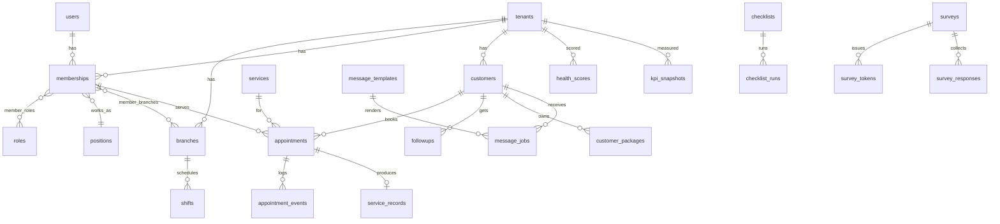

# 03 — ฐานข้อมูล

**PostgreSQL 16** (เริ่มบน Railway — ดู [07-deploy-railway.md](07-deploy-railway.md)) · ORM: **Drizzle** · migration: `drizzle-kit generate` แล้ว review SQL ทุกครั้งก่อน commit

> **แหล่งความจริงของ schema คือ [12-database-ddl.sql](12-database-ddl.sql)** (ทดสอบรันบน Postgres 16 แล้ว) ไฟล์นี้อธิบายหลักคิด ถ้าคอลัมน์ในไฟล์นี้ต่างจาก DDL ให้ยึด DDL

## หลัก "แน่น" + "ยืดหยุ่น"

| แน่น (ข้อมูลผิดไม่ได้) | ยืดหยุ่น (ธุรกิจเปลี่ยนได้โดยไม่แก้ schema) |
|---|---|
| **Composite FK `(tenant_id, id)`** — แถวลูกอ้างข้ามร้านไม่ได้ในระดับ DB | `custom_fields jsonb` + `field_definitions` ต่อร้าน |
| **RLS + FORCE** ทุกตาราง tenant, ตารางที่มีแถวกลางอ่านได้ทั้งของร้านและของกลาง | `metadata jsonb` บนตารางหลัก สำหรับข้อมูลที่ยังไม่แน่ใจ (ย้ายเป็นคอลัมน์เมื่อใช้จริง) |
| **Exclusion constraint** กันนัดชนทั้งพนักงานและห้อง | `rule_sets` (คิว ค่ามือ การจอง ส่วนลด) มี `schema_version` + `effective_from` ไม่ทับของเดิม |
| **CHECK** ทุก enum ตัวเลข ช่วงเวลา (`end_at > start_at`, ส่วนลด ≤ ยอด, ส่วนลดต้องมีเหตุผล, override คิวต้องมีเหตุผล) | `industry_templates (key, version)` ร้านอ้างเวอร์ชันที่ใช้ |
| **Unique ตามธุรกิจ** (เลขบิลต่อสาขา, 1 service record ต่อ 1 นัด, `message_jobs.dedupe_key` กันส่งซ้ำ, ลิ้นชักเปิดได้ทีละ 1) | `external_systems` + `external_refs` ต่อ POS/โปรแกรมคลินิกได้ทุกยี่ห้อ |
| **Append-only** สำหรับเงินและประวัติ (`commission_ledger`, `appointment_events`, `audit_logs`) | enum เป็น `text + check` เพิ่มค่าได้ด้วย migration สั้น ๆ |
| **Optimistic lock** `version` + trigger | `impact_events.kind`, `kpi_snapshots.kpi_key` เพิ่มชนิดใหม่ได้ไม่ต้องเพิ่มตาราง |

## กติกา migration (กันพัง)

1. **Expand → migrate → contract**: เพิ่มคอลัมน์ใหม่ (nullable) → เขียนทั้งสองที่/ย้ายข้อมูล → deploy โค้ดใหม่ → ลบของเก่าใน release ถัดไป ห้ามเปลี่ยนชื่อ/ลบคอลัมน์ใน release เดียว
2. สร้าง index บนตารางใหญ่ด้วย `create index concurrently` (migration แยกไฟล์ ไม่อยู่ใน transaction)
3. ทุก migration ต้องผ่าน CI ที่รันบน Postgres จริง + test tenancy
4. ห้ามแก้ไฟล์ migration ที่ merge แล้ว
5. ข้อมูล seed ของ template/คำถาม แยกจาก schema migration (รันซ้ำได้ idempotent)

ทำไม Postgres: ข้อมูลสัมพันธ์กันชัด (ร้าน → สาขา → นัด → บริการ → ค่ามือ), ต้องการ transaction ที่ถูกต้องเรื่องเงิน, มี **Row Level Security** แยกข้อมูลร้าน, มี **JSONB** สำหรับ custom fields และกติกา, ขยายได้ไกล (read replica, partition)

---

## 1. ข้อตกลง

| เรื่อง | ข้อตกลง |
|---|---|
| ชื่อ | `snake_case`, ตารางพหูพจน์ (`appointments`) |
| PK | `id uuid` (UUID v7 จาก app) |
| Tenant | ทุกตารางข้อมูลร้านมี `tenant_id uuid not null` + index นำหน้าด้วย `tenant_id` |
| Branch | ตารางหน้างานมี `branch_id uuid` |
| เวลา | `timestamptz` ทุกคอลัมน์ ; `created_at`, `updated_at` default `now()` |
| ลบ | `deleted_at timestamptz null` (soft delete) + partial index `where deleted_at is null` |
| เงิน | `bigint` หน่วยสตางค์ + `currency char(3)` ที่ระดับ tenant |
| enum | ใช้ `text` + `check` constraint (เพิ่มค่าได้ง่ายกว่า pg enum) และประกาศ enum ใน `packages/schema` |
| JSON | `jsonb` ต้องมี Zod schema คู่เสมอ, ใส่ `schema_version int` ถ้าเป็นกติกา |
| optimistic lock | `version int not null default 1` ในตารางที่แก้พร้อมกันได้ |
| ข้อมูลอ่อนไหว | เข้ารหัสระดับคอลัมน์ (AES-256-GCM ฝั่ง app, key จาก env/KMS) + คอลัมน์ `*_hash` (HMAC) ไว้ค้นหา |

---

## 2. ERD (ภาพรวม)



---

## 3. ตาราง

### 3.1 Platform / Core

**`users`** — คนที่ล็อกอินได้ (ข้ามร้าน)
`id, name, email (unique, null), email_verified_at, email_verified bool, two_factor_enabled bool, password_hash (null), line_user_id (unique, null), avatar_url, locale ('th'), totp_secret_enc (null), last_login_at, created_at, updated_at`

ตาราง Better Auth (ไม่มี `tenant_id`, ไม่เปิด RLS — เข้าถึงผ่าน `withPublicTx`) — id เป็น uuid, FK `user_id → users(id) on delete cascade`:
`sessions: id, user_id, token (unique), expires_at, ip_address, user_agent, active_tenant_id, created_at, updated_at`
`accounts: id, user_id, account_id, provider_id, access_token, refresh_token, id_token, access_token_expires_at, refresh_token_expires_at, scope, password, created_at, updated_at` (unique `provider_id, account_id`)
`verifications: id, identifier, value, expires_at, created_at, updated_at`
`two_factors: id, user_id, secret, backup_codes`

**`tenants`**
`id, slug (unique), name, legal_name, industry_key → industry_templates.key, template_version, logo_url, brand_color, timezone ('Asia/Bangkok'), currency ('THB'), locale ('th'), country ('TH'), status ('trial'|'active'|'paused'|'closed'), plan_id, settings jsonb, terminology jsonb, quiet_hours jsonb ({start:'21:00',end:'08:00'}), data_retention_days int, created_at, updated_at, deleted_at`

`settings` ตัวอย่าง: `{ booking: { enabled, leadTimeMin, allowChooseStaff }, followups: { concernKeywords: [...] }, review: { googlePlaceUrl } }`

**`branches`**
`id, tenant_id, name, code, address, lat, lng, phone, opening_hours jsonb ({mon:[["09:00","20:00"]],...}), status, created_at, updated_at, deleted_at`

**`branch_resources`** — ห้อง เตียง เก้าอี้
`id, tenant_id, branch_id, name, type ('room'|'bed'|'chair'|'station'), capacity int, active`

**`positions`**
`id, tenant_id, name, code, level int, is_customer_facing bool, sort`

**`roles`** · **`role_permissions`**
`roles: id, tenant_id (null = system role), key, name, is_system`
`role_permissions: role_id, permission text` (PK คู่)

**`memberships`** — user × tenant
`id, tenant_id, user_id, display_name, position_id, employment_type ('full'|'part'|'freelance'), started_on date, ended_on date, status ('invited'|'active'|'inactive'), skills uuid[] (service ids), reports_to_membership_id, phone_enc, created_at, updated_at`

**`membership_roles`** (`membership_id, role_id`) · **`membership_branches`** (`membership_id, branch_id`) — ไม่มีแถว = ทุกสาขา

**`invites`**
`id, tenant_id, token_hash, position_id, role_ids uuid[], branch_ids uuid[], created_by, expires_at, accepted_by_user_id, accepted_at`

**`plans`** · **`plan_modules`** · **`plan_limits`** · **`tenant_modules`** · **`subscriptions`**
`plans: id, code, name, price_minor, interval ('month'|'year'), active`
`plan_modules: plan_id, module_key`
`plan_limits: plan_id, key ('branches'|'members'|'customers'|'messages_per_month'), value int`
`tenant_modules: tenant_id, module_key, source ('plan'|'addon'|'trial'), enabled_until`
`subscriptions: id, tenant_id, plan_id, status, current_period_start, current_period_end, provider, provider_ref`

**`field_definitions`** — custom fields (ดู 05 §3)
`id, tenant_id, entity ('customer'|'appointment'|'service'|'membership'|'service_record'), key, label jsonb ({th,en}), type ('text'|'number'|'date'|'select'|'multiselect'|'boolean'), options jsonb, required bool, sort, archived_at`

**`org_profiles`**
`tenant_id (PK), size_band, compensation_types text[], owner_presence, structure, symptoms text[], updated_at`

**`audit_logs`**
`id, tenant_id, actor_user_id, actor_type ('member'|'platform'|'system'|'customer'), impersonating bool, action, entity, entity_id, diff jsonb, reason, ip_hash, created_at` (append-only, partition รายเดือนเมื่อใหญ่)

**`outbox_events`**
`id bigserial, tenant_id, type, payload jsonb, created_at, processed_at, attempts int, last_error`
index: `(processed_at) where processed_at is null`

**`idempotency_keys`**
`tenant_id, key, request_hash, response jsonb, status_code, created_at` PK (`tenant_id`,`key`)

**`files`**
`id, tenant_id, purpose, storage_key, mime, size, uploaded_by, created_at`

**`imports`** / **`exports`**
`id, tenant_id, type, status, file_id, params jsonb, result jsonb, created_by, created_at, finished_at`

### 3.2 CRM

**`customers`**
`id, tenant_id, code, display_name, phone_enc, phone_hash, email_enc, birth_date, gender, line_user_id, line_channel_account_id, tags text[], stage, preferred_branch_id, preferred_membership_id, owner_membership_id, source ('walk_in'|'line'|'liff'|'import'|'referral'|...), consent_messaging bool, consent_at, consent_source, custom_fields jsonb, last_visit_at, next_due_at, visit_count int, created_at, updated_at, deleted_at, erased_at`
index: `(tenant_id, phone_hash)`, `(tenant_id, line_user_id)`, `(tenant_id, next_due_at)`, GIN `(tags)`, trigram บน `display_name` (pg_trgm)

**`service_categories`** · **`services`**
`services: id, tenant_id, category_id, name, description, duration_min, buffer_min, price_minor, rebook_after_days, followup_plan jsonb ([{afterDays:1, type:'message', templateKey:'post_care_d1'}, ...]), resource_type, required_skill bool, active, sort, custom_fields jsonb`

**`package_products`** · **`customer_packages`** · **`package_usages`**
`package_products: id, tenant_id, name, service_ids uuid[], sessions int, valid_days int, price_minor, active`
`customer_packages: id, tenant_id, customer_id, package_product_id, sessions_total, sessions_used, purchased_at, expires_at, sold_by_membership_id, branch_id`
`package_usages: id, tenant_id, customer_package_id, appointment_id, used_at`

**`appointments`**
`id, tenant_id, branch_id, customer_id, service_id, membership_id (null = ยังไม่กำหนด), resource_id, start_at, end_at, status, source ('front_desk'|'liff'|'phone'|'walk_in'|'import'), customer_package_id, note, custom_fields jsonb, version, created_by, created_at, updated_at`
index: `(tenant_id, branch_id, start_at)`, `(tenant_id, membership_id, start_at)`, `(tenant_id, customer_id, start_at desc)`
กันชนเวลา: exclusion constraint (`btree_gist`) บน `(membership_id, tstzrange(start_at,end_at))` และ `(resource_id, tstzrange(...))` เฉพาะสถานะ active

```sql
alter table appointments add constraint no_overlap_member
  exclude using gist (membership_id with =, tstzrange(start_at, end_at) with &&)
  where (status in ('booked','confirmed','checked_in','in_service') and membership_id is not null);
```

**`appointment_events`**
`id, tenant_id, appointment_id, from_status, to_status, actor_type, actor_id, reason, created_at`

**`followups`**
`id, tenant_id, branch_id, customer_id, appointment_id, type ('post_care'|'no_show'|'rebook_due'|'lapsed'|'package_expiring'|'manual'|'concern'), due_at, assignee_membership_id, priority ('normal'|'urgent'), status ('open'|'done'|'snoozed'|'cancelled'), outcome, note, completed_by, completed_at, created_at`
index: `(tenant_id, status, due_at)`, `(tenant_id, assignee_membership_id, status)`

### 3.3 Messaging

**`channel_accounts`** — LINE OA ของร้าน (และช่องทางอื่นในอนาคต)
`id, tenant_id, provider ('line'|'sms'|'email'|...), name, external_id (channel id), secret_enc, access_token_enc, liff_id, webhook_path_key, status, quota_cache jsonb, created_at`

**`line_followers`**
`id, tenant_id, channel_account_id, line_user_id, display_name, followed_at, unfollowed_at, customer_id`

**`message_templates`**
`id, tenant_id (null = global จาก template), key, trigger, channel ('line'), locale, name, content jsonb (text หรือ flex + ปุ่ม), variables text[], version, active`

**`message_plans`** — จังหวะส่ง
`id, tenant_id, trigger ('appointment.created'|'appointment.reminder'|'appointment.no_show'|'service.completed'|'rebook.due'|'package.expiring'|'customer.lapsed'), offset_minutes int, template_key, enabled, branch_id (null = ทุกสาขา), service_category_id (null = ทุกบริการ)`

**`message_jobs`**
`id, tenant_id, customer_id, appointment_id, plan_id, template_id, channel_account_id, send_at, status ('scheduled'|'sent'|'failed'|'cancelled'|'skipped'), skip_reason, attempts, sent_at, provider_message_id, created_at`
index: `(status, send_at)`, `(tenant_id, appointment_id)`

**`message_logs`**
`id, tenant_id, customer_id, direction ('out'|'in'), channel, content_summary, template_key, related jsonb, created_at` (เก็บข้อความขาเข้าแบบย่อ ไม่เก็บรูป)

### 3.4 Operations

**`shift_templates`** `id, tenant_id, branch_id, name, start_time, end_time, duties jsonb`
**`shifts`** `id, tenant_id, branch_id, membership_id, date, start_time, end_time, shift_template_id, duties jsonb, status ('planned'|'swapped'|'absent'|'leave'), version`
**`shift_swap_requests`** `id, tenant_id, shift_id, requested_by, target_membership_id, status, decided_by, decided_at`
**`attendance`** (อนาคต) `id, tenant_id, membership_id, branch_id, clock_in, clock_out, source`
**`checklists`** `id, tenant_id, name, branch_ids uuid[], position_ids uuid[], schedule jsonb, active`
**`checklist_items`** `id, tenant_id, checklist_id, text, require_photo, require_note, sort`
**`checklist_runs`** `id, tenant_id, checklist_id, branch_id, date, shift_id, started_by, status ('open'|'done'|'overdue'), completed_at`
**`checklist_run_items`** `run_id, item_id, done, done_by, done_at, note, photo_file_id`
**`sops`** `id, tenant_id, title, body_md, position_ids uuid[], service_ids uuid[], version, published_at, archived_at`
**`sop_acknowledgements`** `sop_id, version, membership_id, acknowledged_at`

### 3.5 Surveys / Health / Reports

**`question_bank`**
`id, tenant_id (null = กลาง), dimension ('D1'..'D7'), key, text jsonb ({th,en, byIndustry:{spa:{th:...}}}), scale ('likert5'|'nps10'|'text'), reverse bool, active`

**`surveys`** `id, tenant_id, title, question_ids uuid[], audience jsonb, opens_at, closes_at, anonymity_threshold int default 5, status`

**`survey_tokens`** — ห้ามผูกกับ response
`id, tenant_id, survey_id, membership_id, token_hash, issued_at, used bool`
> หลังใช้ token: set `used = true` เท่านั้น **ไม่บันทึก response_id**

**`survey_responses`** — ไม่มี membership_id
`id, tenant_id, survey_id, branch_id, position_id (null ได้ ถ้ากลุ่มเล็กเกิน), submitted_on date (ปัดเป็นวัน), answers jsonb ({questionId: value})`
> ลำดับการ insert ต้องไม่เดาได้: worker รวมคำตอบแล้ว insert เป็น batch สุ่มลำดับทุก 1 ชม.

**`rubric_scores`** (จากที่ปรึกษา) `id, tenant_id, audit_id, dimension, criterion_key, score int, evidence, scored_by, created_at`
**`health_scores`** `id, tenant_id, branch_id (null = ทั้งร้าน), period ('2026-10'), dimension ('D1'..'D7'|'overall'), score numeric(5,2), survey_component, rubric_component, metric_component, sample_size, computed_at`

**`anon_reports`** `id, tenant_id, branch_id, category, body, status ('new'|'in_progress'|'resolved'|'closed'), assignee_membership_id, route_to_platform bool, secret_hash, created_hour timestamptz (ปัดชั่วโมง), resolved_at`
**`anon_report_messages`** `id, tenant_id, report_id, author ('reporter'|'handler'), body, created_hour`

### 3.6 Payouts

**`rule_sets`** — กติกาทุกชนิดเก็บที่เดียว
`id, tenant_id, kind ('queue'|'compensation'|'booking'), branch_id (null = ทุกสาขา), schema_version, body jsonb, effective_from date, created_by, created_at`
> ไม่ update แถวเดิม — สร้างแถวใหม่เสมอ คำนวณย้อนหลังใช้กติกาที่มีผล ณ วันนั้น

**`queue_assignments`** `id, tenant_id, branch_id, appointment_id, membership_id, rule_set_id, reason, overridden bool, override_reason, assigned_by, created_at`
**`queue_state`** `tenant_id, branch_id, date, state jsonb` (ตัวชี้ลำดับเวียน)

**`service_records`**
`id, tenant_id, branch_id, appointment_id, customer_id, service_id, membership_id, assistant_membership_ids uuid[], performed_at, price_minor, discount_minor, paid_minor, tip_minor, customer_package_id, is_requested_by_customer bool, sale_membership_id, custom_fields jsonb, payout_period_id, locked bool`

**`commission_ledger`** — ผลการคำนวณ (append-only)
`id, tenant_id, membership_id, service_record_id, rule_set_id, component ('base'|'hand_fee'|'commission'|'tip'|'bonus'|'adjustment'), amount_minor, explain jsonb, created_at`

**`payout_periods`** `id, tenant_id, branch_id, starts_on, ends_on, status ('open'|'closed'), closed_by, closed_at`
**`payout_statements`** `id, tenant_id, payout_period_id, membership_id, total_minor, breakdown jsonb, file_id`

### 3.7 KPI

**`kpi_snapshots`**
`tenant_id, branch_id (null = รวม), kpi_key, grain ('day'|'week'|'month'), period_start date, value numeric, numerator numeric, denominator numeric, computed_at`
PK (`tenant_id`, `branch_id`, `kpi_key`, `grain`, `period_start`) — ใช้ `coalesce(branch_id, '00000000-...')` ใน unique index

### 3.8 Platform (ทีม CoreUp)

**`industry_templates`** `key, version, name jsonb, body jsonb, published_at` (PK `key,version`) ดู 05 §1
**`platform_assignments`** `user_id, tenant_id, role ('consultant'|'sales'), assigned_at`
**`leads`** `id, business_name, contact_name, phone_enc, line_id, industry_key, branch_count, staff_count, province, pain_points text[], message, stage, owner_user_id, next_action_at, utm jsonb, source, lost_reason, converted_tenant_id, created_at`
**`lead_activities`** `id, lead_id, type ('call'|'chat'|'visit'|'meeting'|'note'|'proposal'), note, at, by_user_id`
**`audits`** `id, tenant_id, status, started_on, report_file_id, consultant_user_id`
**`audit_findings`** `id, audit_id, dimension, severity, title, body`
**`action_plans`** `id, audit_id, items jsonb ([{title, dimension, ownerMembershipId, dueOn, status}])`

### 3.9 เพิ่มหลัง DDL ชุดแรก (migration 0004–0010)

| Migration | เปลี่ยนอะไร | ทำไม |
|---|---|---|
| 0004 | `shift_swap_requests`, `push_subscriptions` (RLS), `sop_acknowledgements.tenant_id` + RLS + composite FK | แลกเวร (§3.4), web push (04 §8), เดิม sop_acknowledgements ไม่มี tenant_id → อ่านข้ามร้านได้ |
| 0005 | `imports` (`type` เปิดกว้าง: customers / services / pos_daily …) | งาน import CSV + คิว `import.run` |
| 0006 | `followups.dedupe_key` + unique partial; `two_factors.{verified,failed_verification_count,locked_until}`; `line_followers`; `app_channel_account_by_id()`; trigger append-only บน `commission_ledger`, `appointment_events`, `audit_logs` | cron สร้างงานติดตามซ้ำไม่ได้, Better Auth 2FA, LINE follow/unfollow, webhook ยังไม่รู้ tenant, AGENTS กฎ 16 บังคับที่ DB (UPDATE/DELETE → SQLSTATE 23514) |
| 0007 | `refunds.method` | ยอดเงินสดที่ควรมีในลิ้นชัก (11 §4) |
| 0008 | `message_jobs.vars` | ข้อความครั้งเดียวที่มีตัวแปรของตัวเอง (เช่น ใบเสร็จ) |
| 0009 | RLS บน `vacation_tests`, `invoices` | route ฝั่งร้านอ่าน/เขียนผ่าน `withTenantTx`; ฝั่ง platform ใช้ role bypassrls |
| 0010 | `app_last_invoice_number(prefix)` + policy `owner_lookup` บน invoices | เลขใบแจ้งหนี้ `INV-YYYYMM-####` เป็นของทั้งระบบ แต่ตารางถูก RLS แยกร้าน |

SQL ฉบับเต็มอยู่ท้าย `12-database-ddl.sql` §10

---

## 4. Row Level Security

ทุกตารางที่มี `tenant_id` (ยกเว้นตาราง platform)

```sql
alter table customers enable row level security;
alter table customers force row level security;

create policy tenant_isolation on customers
  using (tenant_id = current_setting('app.tenant_id', true)::uuid)
  with check (tenant_id = current_setting('app.tenant_id', true)::uuid);
```

- สร้าง policy ให้ทุกตารางด้วย migration helper (`packages/db/src/rls.ts` สร้าง SQL จากรายชื่อตาราง) — มี test ตรวจว่า **ทุกตารางที่มี `tenant_id` เปิด RLS แล้ว**
- Role ฐานข้อมูล:
  - `coreup_owner` — เจ้าของ schema ใช้รัน migration
  - `coreup_app` — API + worker ใช้ **ไม่มี** `BYPASSRLS`, ไม่ใช่ superuser
  - `coreup_platform` — งาน platform/cron ข้ามร้าน มี `BYPASSRLS` ใช้เฉพาะใน worker โค้ดที่ระบุ
- ถ้าไม่ได้ `set_config('app.tenant_id')` query จะได้ 0 แถว (ปลอดภัยโดย default)

## 5. Index และประสิทธิภาพ

- ทุก FK มี index
- query หลักต่อหน้าจอ ต้องมี index รองรับ และเช็กด้วย `EXPLAIN` ใน PR (ปฏิทินนัด, today-board, followups วันนี้, customers search)
- เปิด extension: `pgcrypto`, `pg_trgm`, `btree_gist`, `citext`
- เมื่อ `audit_logs`, `message_logs`, `outbox_events` เกิน ~10 ล้านแถว → partition รายเดือน
- Connection pool: API ใช้ `postgres` (postgres.js) pool 10 ต่อ instance; worker 5

## 6. Seed

`pnpm db:seed` สร้าง

- plans 3 ระดับ + modules
- industry templates: `generic`, `clinic`, `dental`, `spa`, `massage`, `salon`, `restaurant`
- คลังคำถาม 7 ด้าน (ด้านละ 8–10 ข้อ)
- ร้านตัวอย่าง 3 ร้าน (คลินิก 1 สาขา, สปา 2 สาขา, ร้านสระผม 1 สาขา) พร้อมพนักงาน ลูกค้า นัดย้อนหลัง 90 วัน — **ใช้ข้อมูลสมมติเท่านั้น**
- ทีม CoreUp: user admin 1 คน

## 7. Backup / retention

- Railway backup รายวัน + `pg_dump` รายวันไป R2 (เก็บ 30 วัน) — ทดสอบ restore ทุกเดือน
- `tenants.data_retention_days` (default 730) worker anonymize ลูกค้าที่ไม่มีความเคลื่อนไหวเกินกำหนด
- ร้านเลิกใช้: export ให้ร้าน → ลบภายใน 30 วันตามสัญญา
