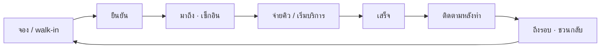

# 08 — หน้างานที่เชื่อมกันทั้งหมด: ปฏิทิน คิว ปิดวัน รายงาน

ไฟล์นี้เติมส่วนที่ผูกทุกโมดูลเข้าด้วยกัน และตอบคำถาม "ระบบช่วยลดงานได้จริงไหม" อ่านคู่กับ 02 (API) และ 04 (หน้าบ้าน)

---

## 1. ตรวจโจทย์: ตรงจุดไหม ลดงานได้จริงไหม

### 1.1 ตรงจุดแน่นอน

| ปัญหาหน้างาน | ระบบแก้ด้วย | ลดงานเพราะ |
|---|---|---|
| ลูกค้าลืมนัด / ไม่มา | LINE ยืนยัน + เตือนอัตโนมัติ + ปุ่มยืนยัน | แอดมินไม่ต้องไล่โทรทีละคน |
| ไม่มีใครตามลูกค้าหลังทำ / ถึงรอบ | follow-up สร้างเองจากบริการ | ไม่ต้องจำ ไม่ต้องเปิดสมุด |
| แย่งคิว แย่งลูกค้า | กติกาคิวที่ทุกคนเห็นเหตุผล | ลดการทะเลาะ ลดเวลาเจ้าของมาตัดสิน |
| เจ้าของต้องโทรถามว่าร้านเปิดเรียบร้อยไหม | เช็กลิสต์ + สรุปปิดวันส่งเข้า LINE | เจ้าของไม่ต้องเฝ้า |
| คิดค่ามือสิ้นเดือนนาน ทะเลาะกัน | ค่ามือคิดจากงานที่ปิดจริง พนักงานเห็นเองทุกวัน | ไม่ต้องคิดมือ ไม่ต้องอธิบายซ้ำ |
| คนใหม่ไม่มีใครสอน | การ์ดหน้าที่ต่อกะ + คู่มือสั้น | คนเก่าไม่ต้องสอนซ้ำทุกคน |

### 1.2 จุดเสี่ยงที่ทำให้ "เพิ่มงาน" แทน "ลดงาน" (ต้องแก้ในการออกแบบ)

| ความเสี่ยง | ทำไมอันตราย | วิธีกัน |
|---|---|---|
| **กรอกซ้ำกับระบบเดิม** (POS / โปรแกรมคลินิก) | พนักงานต้องลงข้อมูล 2 ที่ → เลิกใช้ภายใน 2 สัปดาห์ | กำหนดให้ CoreUp เป็น **ที่เดียวที่ลงนัดและคิว** ส่วนเงินให้ POS เดิมทำ แล้ว import ยอดรายวัน (CSV/ต่อ API ภายหลัง) — ขายให้ชัดว่าเราไม่แทน POS |
| **บันทึกบริการเป็นงานแยก** | ถ้าต้องกรอกหลังทำทุกครั้ง = งานเพิ่ม | บันทึกบริการ **เกิดเองเมื่อกด "เสร็จ"** บนนัด/คิว แก้เฉพาะที่ต่างจากที่จองไว้ |
| **ฟีเจอร์เยอะเกินสำหรับร้านเล็ก** | ร้าน 5 คนเปิดมาเจอ 20 เมนู = งง | **โหมดร้านเล็ก**: 3 หน้าจอหลัก (วันนี้ · ลูกค้า · ของฉัน) ซ่อนส่วนอื่นจนกว่าจะเปิดใช้ |
| **ต้องตั้งค่าเยอะก่อนใช้** | ร้านไม่มีเวลาตั้งค่า | template ตามธุรกิจตั้งให้ 80% + ทีม CoreUp ตั้งให้ตอน onboard |
| **รายงานเยอะแต่ไม่มีใครอ่าน** | เปลืองแรง dev ไม่มีผล | รายงาน **ส่งไปหาคน** (LINE) แทนให้คนมาเปิดดู ส่งเฉพาะที่ต้องทำอะไรต่อ |
| **ทุกคนต้องมีมือถือ/ล็อกอิน** | พนักงานบางคนไม่สะดวก | iPad หน้าเคาน์เตอร์ใช้ร่วม + สลับคนด้วย PIN 4 หลัก |

### 1.3 "ลดคน" — พูดให้ถูก

ระบบ **ลดชั่วโมงงานธุรการ** ไม่ใช่ไล่คนออก ประโยคที่ขายได้และจริง:

> "คนเท่าเดิม รับลูกค้าได้มากขึ้น และเปิดสาขาใหม่ได้โดยไม่ต้องจ้างแอดมินเพิ่ม"

วิธีประเมินชั่วโมงที่ประหยัดได้ต่อร้าน (ใช้ตัวเลขจริงของร้านตอนออดิท ไม่ใช้ตัวเลขสมมติไปขาย):

```
ชม.ต่อวันที่ประหยัด ≈ (นัดต่อวัน × จำนวนครั้งที่ต้องทัก/โทรต่อนัด × นาทีต่อครั้ง
                     + เคสติดตามต่อวัน × นาทีต่อเคส
                     + นาทีคิดค่ามือต่อเดือน ÷ วันทำงาน
                     + นาทีที่เจ้าของโทรเช็กร้านต่อวัน) ÷ 60
```

ตัวอย่างการคิด (สมมติ): นัด 40/วัน × ทัก 2 ครั้ง × 1.5 นาที = 120 นาที → ประมาณ 2 ชม./วัน จากงานเตือนนัดอย่างเดียว — ใส่ตัวเลขจริงของร้านนำร่องในเคสก่อน–หลังแทน

---

## 2. วงจรหลัก (Core loop) — ทุกอย่างแขวนอยู่บนเส้นนี้



**หนึ่งการกด → หลายอย่างเกิดเอง** (ไม่ต้องกรอกซ้ำ)

| พนักงานกด | ระบบทำต่อเอง |
|---|---|
| ลงนัด | ส่ง LINE ยืนยัน · ตั้งเตือน 1 วัน/3 ชม. · กันเวลาพนักงานและห้อง · ตัดสิทธิ์คอร์สล่วงหน้า (hold) |
| ลูกค้ากดยืนยันใน LINE | สถานะเขียวบนปฏิทิน · ออกจากรายการ "ต้องโทรเช็ก" |
| เช็กอิน | ออกจากรายการรอ · เริ่มนับเวลารอ · แจ้งพนักงานที่รับเคส |
| เสร็จ | สร้างบันทึกบริการ → ค่ามือ · ตัดคอร์ส · สร้างงานติดตาม D1/D3/D7 · ตั้งวันถึงรอบ · นับ KPI · ปลดห้อง/คนให้คิวถัดไป |
| ไม่มา (หรือระบบตั้งเองหลังเลยเวลา X นาที) | งานทักกลับวันนี้ · นับ no-show · เปิดช่องว่างให้ walk-in |
| พนักงานลา/ป่วย | ปฏิทินแจ้งนัดที่กระทบ · เสนอคนแทนที่ว่างและมีทักษะ · ส่ง LINE แจ้งลูกค้าถ้าเปลี่ยนคน (ร้านเลือกได้) |

---

## 3. ปฏิทิน (Calendar) — รวมนัด กะ ลา ห้อง ในที่เดียว

### 3.1 มุมมอง

| มุมมอง | ใช้กับ | แสดง |
|---|---|---|
| **วัน · ตามพนักงาน** (default หน้าร้าน) | iPad | คอลัมน์ต่อคนที่ **อยู่กะวันนี้** · นัด · ช่วงพัก · ลา (แถบลาย) |
| **วัน · ตามห้อง/เตียง** | สปา คลินิกที่ห้องจำกัด | คอลัมน์ต่อห้อง |
| **สัปดาห์** | หัวหน้า | ภาพรวมความแน่น |
| **เดือน** | เจ้าของ | จำนวนนัด/วัน + สีความแน่น (heatmap) |
| **รายการ** | มือถือ | เรียงเวลา อ่านง่าย |
| **หลายสาขา** | เจ้าของ | เลือกสาขาซ้อนกันหรือสลับดู |

### 3.2 กติกาที่ปฏิทินบังคับ

- จองพนักงานที่ **ไม่อยู่กะ / ลา** ไม่ได้ (หัวหน้าบังคับข้ามได้ + เหตุผล)
- ชนเวลา พนักงานหรือห้อง ไม่ได้ (exclusion constraint ใน DB)
- เวลาเผื่อ (buffer) หลังบริการตามที่ตั้งในบริการ
- เวลาเปิดปิดสาขา + วันหยุดสาขา (`branch_closures`)
- ลากวางเพื่อเลื่อน → ถามว่าจะส่ง LINE แจ้งลูกค้าไหม

### 3.3 ข้อมูลที่ต้องเพิ่ม

`leave_requests` `id, tenant_id, membership_id, type ('sick'|'personal'|'vacation'), starts_at, ends_at, status ('pending'|'approved'|'rejected'), approver, reason`
`branch_closures` `id, tenant_id, branch_id, date, reason`
`breaks` ใน `shifts.duties` หรือ `shift_breaks (shift_id, start, end)`

API: `GET /v1/calendar?view=day&by=member|resource&branchId=&date=` คืน **ทุกชั้นในครั้งเดียว**: `{ columns, appointments, shifts, leaves, breaks, closures, capacity }` → หน้าบ้านไม่ต้องยิงหลาย request

---

## 4. คิว (Queue) — นัด + walk-in + การจ่ายงาน

### 4.1 สามส่วน

| ส่วน | ทำอะไร |
|---|---|
| **รายการรอ (Waitlist)** | walk-in ลงชื่อ (หน้าร้าน หรือสแกน QR ลงคิวเองผ่าน LIFF) · เห็นลำดับ · เวลารอโดยประมาณ · ส่ง LINE เรียกเมื่อใกล้ถึง |
| **คิวพนักงาน (Rotation)** | ใครรับลูกค้าคนถัดไป ตามกติกาคิว + เหตุผลที่อ่านได้ |
| **กระดานคิว (Queue board)** | จอทีวี/แท็บเล็ตในร้าน แสดงหมายเลขคิว ไม่แสดงชื่อเต็ม (`มายด์ ก.` หรือเลขคิว) |

### 4.2 ตรรกะจับคู่ (domain)

```
เมื่อมีคนว่าง หรือมีลูกค้าใหม่เข้าคิว:
  1. นัดที่ถึงเวลาแล้ว ได้ก่อนเสมอ
  2. walk-in ตามลำดับมาถึง (หรือ priority ที่ร้านตั้ง)
  3. เลือกพนักงานตามกติกาคิว: ขอคนเดิม → ทักษะ → เวียน/ว่างนานสุด
  4. ห้าม walk-in กินเวลาที่ชนนัดถัดไปของพนักงานคนนั้น (ใช้ duration บริการ + buffer)
```

### 4.3 ข้อมูลที่ต้องเพิ่ม

`waitlist_entries` `id, tenant_id, branch_id, customer_id (null ได้), display_name, party_size, service_id, requested_membership_id, joined_at, called_at, served_at, left_at, status ('waiting'|'called'|'serving'|'done'|'left'), source ('front_desk'|'liff_qr')`

API: `GET/POST /v1/waitlist`, `POST /v1/waitlist/:id/call`, `GET /v1/queue/board?branchId=` (public token ต่อจอ, read-only), SSE `GET /v1/stream/branch/:id` สำหรับอัปเดตสด (ปฏิทิน คิว บอร์ด)

---

## 5. ปิดวัน (Daily close) — จุดที่เจ้าของเหนื่อยที่สุด

ทุกวันตอนปิดร้าน หัวหน้ากด **"ปิดวัน"** (หรือระบบปิดเองตามเวลา)

| ตรวจ | มาจาก |
|---|---|
| นัดที่ยังค้างสถานะ (ไม่ได้กดเสร็จ/ไม่มา) | appointments → ต้องเคลียร์ก่อนปิด |
| เช็กลิสต์ปิดร้านครบไหม | checklist_runs |
| จำนวนบริการ / ยอดตามระบบ vs ยอดจาก POS หรือที่หน้าร้านกรอก | service_records vs `daily_close.declared_*` |
| ทิปรวมและการแบ่ง | service_records.tip |
| ส่วนลดที่ให้วันนี้ + เหตุผล | service_records.discount |
| ส่งเวร: ข้อความถึงกะพรุ่งนี้ | `daily_close.handover_note` |
| เรื่องด่วนค้าง | followups urgent, anon_reports ใหม่ |

ผล: **สรุปปิดวันส่งเข้า LINE เจ้าของ** อัตโนมัติ (ข้อความสั้น + ลิงก์ดูละเอียด) และแสดงต้นกะพรุ่งนี้ใน `/me/today`

`daily_closes` `id, tenant_id, branch_id, date, closed_by, closed_at, totals jsonb, declared_cash_minor, declared_transfer_minor, variance_minor, handover_note, issues jsonb`

---

## 6. ระบบรายงาน (Reports) — ส่งหาคน ไม่ต้องให้คนมาหา

### 6.1 หลัก

1. ทุกรายงานมาจาก **ข้อมูลชุดเดียว** (appointments, service_records, followups, shifts, checklist_runs, surveys, kpi_snapshots) ไม่มีการกรอกเพื่อทำรายงาน
2. รายงานแบบ **push** (LINE/อีเมล) ตามรอบ + แบบ **เปิดดู** ในระบบ
3. ทุกรายงานต้องตอบได้ว่า **"แล้วต้องทำอะไรต่อ"** — มีส่วน "ต้องจัดการ" เสมอ
4. รายงานสร้างจาก **report definition** (ข้อมูล) → เพิ่มรายงานใหม่โดยไม่แก้หน้าจอ

### 6.2 รายการรายงาน

| รายงาน | ส่งให้ | รอบ | เนื้อหาหลัก |
|---|---|---|---|
| **สรุปปิดวัน** | เจ้าของ, หัวหน้าสาขา | ทุกวันหลังปิด | ลูกค้า/บริการ/ยอด, no-show, เช็กลิสต์, ส่วนลด, เรื่องค้าง, ส่งเวร |
| **เช้านี้ต้องรู้** | หัวหน้าสาขา | ทุกเช้า 08:00 | นัดวันนี้, ยังไม่ยืนยัน, ใครลา, งานติดตามด่วน |
| **สรุปสัปดาห์** | เจ้าของ | จันทร์ 09:00 | KPI 6 ตัวเทียบสัปดาห์ก่อน, สาขาไหนตก, เรื่องที่แจ้งเข้ามา |
| **รายงานเดือน** | เจ้าของ (+ ที่ปรึกษา CoreUp) | ต้นเดือน | KPI ทั้งหมด, คะแนนสุขภาพ, ลาออก/เข้าใหม่, ค่ามือรวม, ข้อเสนอแนะ |
| **รายได้ของฉัน** | พนักงาน | ทุกวัน (ในแอป) + สิ้นงวด (LINE) | งานที่ทำ, ค่ามือ, ทิป, คำอธิบายที่มา |
| **ประสิทธิภาพพนักงาน** | เจ้าของ, หัวหน้า | เดือน | จำนวนงาน, ลูกค้ากลับมาหาคนเดิม, คะแนนลูกค้า, ติดตามครบ — **ใช้พัฒนา ไม่ใช่ลงโทษ** |
| **ลูกค้า** | เจ้าของ | เดือน | ลูกค้าใหม่/กลับมา/หายไป, คอร์สค้าง, ถึงรอบแต่ยังไม่จอง |
| **การใช้ห้อง/เวลา** | เจ้าของ | เดือน | ช่วงเวลาที่ว่าง/แน่น (heatmap ชั่วโมง×วัน) → ใช้วางเวรและโปรโมชันช่วงว่าง |
| **ข้อความ LINE** | เจ้าของ | เดือน | ส่งไปกี่ข้อความ เทียบโควตา, อัตรายืนยัน |
| **ออดิท / 90 วัน** | เจ้าของ | ตามรอบออดิท | คะแนน D1–D7 ก่อน–หลัง, แผนที่ทำแล้ว/ยัง |
| **ภาพรวม CoreUp** | ทีม CoreUp | สัปดาห์ | ร้านที่ตัวเลขตก, ร้านที่ใช้งานน้อย (เสี่ยงเลิกใช้), ต่อสัญญา |

### 6.3 Report definition

```ts
// packages/domain/reports/daily-close.ts
export const dailyClose: ReportDef = {
  key: 'daily_close',
  audience: ['owner', 'branch_manager'],
  schedule: { type: 'on_event', event: 'daily_close.completed' },
  channels: ['line', 'in_app'],
  modules: ['crm'],
  sections: [
    { kind: 'stats', items: ['customers_served', 'services_count', 'revenue_recorded', 'no_show_count'] },
    { kind: 'compare', with: 'same_weekday_last_week' },
    { kind: 'action_list', source: 'open_issues' },      // ต้องจัดการ
    { kind: 'text', source: 'handover_note' },
  ],
};
```

ตาราง: `report_subscriptions (tenant_id, report_key, membership_id, channel, enabled, schedule_override)` · `report_runs (id, tenant_id, report_key, period, payload jsonb, file_id, sent_at)`

API: `GET /v1/reports/catalog`, `GET /v1/reports/:key?period=&branchId=`, `GET/PUT /v1/report-subscriptions`, `POST /v1/reports/:key/export` (PDF/CSV)

ข้อความ LINE ของรายงาน: สั้น ≤ 8 บรรทัด + ปุ่ม "ดูรายละเอียด" (เปิดเว็บหลังบ้าน) — ไม่ใส่ชื่อลูกค้าหรือข้อมูลส่วนบุคคลในข้อความ

---

## 7. จุดปัญหาเพิ่มเติมที่ควรรองรับ (จากหน้างานจริง)

เรียงตามผลกระทบ · ✅ = ทำใน milestone หลัก · ⏳ = ทำภายหลัง

| # | ปัญหา | ฟีเจอร์ | สถานะ |
|---|---|---|---|
| 1 | พนักงานลากะทันหัน นัดพัง | ลา + ปฏิทินแจ้งนัดที่กระทบ + เสนอคนแทน + แจ้งลูกค้า | ✅ M4 |
| 2 | ส่งเวรปากเปล่า ข้อมูลหาย | บันทึกส่งเวรในปิดวัน แสดงต้นกะถัดไป | ✅ M4 |
| 3 | ลดราคาให้คนรู้จัก / ส่วนลดไม่มีที่มา | ส่วนลดต้องเลือกเหตุผล, เกินเพดาน → ขออนุมัติ | ✅ M6 |
| 4 | อนุมัติทุกเรื่องต้องรอเจ้าของ (ลา แลกเวร ส่วนลด) | **กล่องอนุมัติ** เดียว + อนุมัติใน LINE ได้ | ✅ M4–M6 |
| 5 | ลูกค้าร้องเรียนแล้วเรื่องหาย | เคสร้องเรียนลูกค้า: รับเรื่อง → คนรับผิดชอบ → ปิดเรื่อง | ✅ M5 |
| 6 | จอง LINE แชตหลายคนตอบ ลงนัดซ้ำ | ลงนัดที่เดียว + ปุ่ม "จองคิว" ใน LINE (LIFF) | ✅ M3 / booking |
| 7 | walk-in รอนานแล้วกลับ | waitlist + เวลารอโดยประมาณ + เรียกผ่าน LINE | ✅ M6 |
| 8 | จำความชอบลูกค้าไม่ได้ (แรงนวด อุณหภูมิ ช่างคนโปรด) | "ข้อควรรู้" ของลูกค้า (ไม่ใช่ข้อมูลการรักษา) แสดงตอนเช็กอิน | ✅ M2 |
| 9 | คนใหม่ทำผิดขั้นตอน | SOP ผูกกับบริการ เปิดดูจากนัดได้ทันที | ✅ M4 |
| 10 | ของใช้หมดกลางวัน (ผ้า น้ำมัน ยา) | ข้อในเช็กลิสต์แบบ "นับจำนวน" + แจ้งเตือนต่ำกว่าเกณฑ์ (ไม่ทำระบบสต็อกเต็ม) | ⏳ |
| 11 | ไม่มามัดจำไม่มี | มัดจำผ่าน PromptPay ตอนจองออนไลน์ (เปิดเฉพาะร้านที่ต้องการ) | ⏳ |
| 12 | ลงเวลาเข้างานแบบกระดาษ / โกงเวลา | ลงเวลาด้วย QR ที่ร้าน (หมุนรหัสทุก 30 วิ) | ⏳ |
| 13 | iPad ใช้ร่วมกัน ไม่รู้ใครกด | สลับผู้ใช้ด้วย PIN 4 หลัก บน iPad ร่วม | ✅ M2 |

> ข้อ 8: ห้ามเก็บโรค ยา ประวัติการรักษา — ถ้าร้านจำเป็นต้องรู้เรื่องแพ้ ให้เก็บเป็น "มีข้อควรระวัง: ใช่/ไม่" แล้วดูรายละเอียดในระบบคลินิกเดิม

---

## 8. โหมดร้านเล็ก (ลดความซับซ้อน)

`tenant.settings.uiMode = 'simple' | 'full'` — ร้าน ≤ 10 คน + 1 สาขา เริ่มที่ `simple`

| simple เห็น | ซ่อน (เปิดได้ที่ตั้งค่า) |
|---|---|
| **วันนี้** — ปฏิทินวันนี้ + รายการรอ + ต้องทัก | ปฏิทินสัปดาห์/เดือน, มุมมองห้อง |
| **ลูกค้า** — ค้นหา ลงนัด ดูประวัติ | custom fields, merge, import |
| **ของฉัน** — กะ เช็กลิสต์ รายได้ | ตารางเวรแบบลากวาง, กติกาขั้นสูง |
| ตั้งค่าแบบ 1 หน้า | role กำหนดเอง, หลายสาขา, รายงานขั้นสูง |

เป้าหมาย: พนักงานใหม่ใช้เป็นภายใน **15 นาที** โดยไม่ต้องอบรม (ใช้ทดสอบกับร้านนำร่องทุก milestone)

---

## 9. สิ่งที่ต้องเพิ่มในเอกสารอื่น

- 02-api: `/calendar`, `/waitlist`, `/queue/board`, `/stream/branch/:id` (SSE), `/daily-closes`, `/leave-requests`, `/approvals`, `/customer-complaints`, `/reports/*`, `/report-subscriptions`
- 03-database: `leave_requests`, `branch_closures`, `shift_breaks`, `waitlist_entries`, `daily_closes`, `approvals`, `customer_complaints`, `report_subscriptions`, `report_runs`, `customer_notes` (ข้อควรรู้), `device_sessions` (iPad ร่วม + PIN)
- 04-backoffice: หน้า `/today` เพิ่มรายการรอ, `/close` (ปิดวัน), `/approvals`, `/reports`, `/board/:token` (จอคิว), สลับผู้ใช้ด้วย PIN, `uiMode`
- 06-roadmap: เพิ่มงานตามตาราง §7
