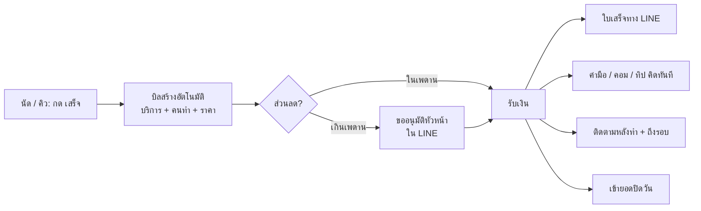

# 11 — POS: อยู่คู่ แทนบางส่วน หรือแทนทั้งหมด

คำถาม: ระบบเราจะแทน POS เดิมของร้านได้ไหม และควรทำแค่ไหน

คำตอบสั้น: **แทน "งานที่ POS ไม่ได้ทำ" ก่อน แล้วค่อยกินส่วนรับเงินของร้านเล็กที่ไม่มี POS จริง** ไม่แข่งแทน POS เต็มรูปแบบของร้านที่จด VAT หรือคลินิกที่มีโปรแกรมเวชระเบียน

---

## 1. POS เดิมของร้านทำอะไร และไม่ทำอะไร

| POS / โปรแกรมเดิมทำได้ดี | สิ่งที่ POS ส่วนใหญ่ไม่ทำ (ปัญหาจริงของร้าน) |
|---|---|
| รับเงิน ออกใบเสร็จ / ใบกำกับภาษี | ใครทำบริการนี้ → **ค่ามือ คอม ทิป** คิดเองสิ้นเดือน |
| สต็อกสินค้า | **คิว** ใครรับลูกค้าคนถัดไป |
| ยอดขายรายวัน | **ติดตามลูกค้า** หลังทำ ถึงรอบ หายไป |
| รายงานภาษี | **กะ หน้าที่ เช็กลิสต์** |
| | **ปิดวันแบบเห็นทั้งร้าน** (ยอด + คน + เรื่องค้าง) |
| | **ส่วนลดมีเหตุผล / อนุมัติ** |

ร้านจึงต้อง **กรอกซ้ำ**: ลงบิลใน POS แล้วจดอีกที่ว่าใครทำ เพื่อคิดค่ามือ → นี่คือจุดที่เราเข้าไปแทน

## 2. แบ่งร้านเป็น 3 กลุ่ม แล้วเลือกทาง

| กลุ่มร้าน | ตอนนี้ใช้อะไร | ทางที่เลือก |
|---|---|---|
| **A. ไม่มี POS จริง** — สปา ร้านนวด ร้านสระผม ร้านเล็ก ไม่จด VAT | สมุด, เงินสด, โอน/PromptPay, ใบเสร็จเขียนมือ | **แทนได้เลย** ด้วยโมดูล `checkout` (POS-lite) |
| **B. มี POS ทั่วไป** ไม่ซับซ้อน | POS ร้านค้าทั่วไป | **อยู่คู่ก่อน → ย้ายมาเมื่อพร้อม** (ตอนหมดสัญญา POS เดิม) |
| **C. คลินิกที่มีโปรแกรมคลินิก** / ร้านจด VAT ที่ออกใบกำกับภาษีอย่างย่อจาก POS | โปรแกรมคลินิก (เวชระเบียน ยา สต็อก ภาษี) | **ไม่แทน** — เชื่อมข้อมูล ให้ CoreUp ทำงานคน คิว ค่ามือ ติดตาม |

เหตุผลที่ไม่แทนกลุ่ม C:
- เวชระเบียนและยามีข้อกำหนดเฉพาะของสถานพยาบาล ไม่ใช่ธุรกิจของเรา
- POS ที่ออกใบกำกับภาษีอย่างย่อต้องขออนุมัติจากกรมสรรพากร และต้องทำตามข้อกำหนดเรื่องเลขที่เอกสาร รายงาน และการเก็บข้อมูล (ให้นักบัญชียืนยันรายละเอียดก่อนทำ)
- dev คนเดียวทำ POS เต็มรูปแบบ + ภาษี + สต็อก + ฮาร์ดแวร์ ไม่ไหว และไม่ใช่สิ่งที่ทำให้ร้าน "เดินเองได้"

## 3. สามระดับการเชื่อมกับ POS เดิม (กลุ่ม B, C)

| ระดับ | วิธี | ร้านทำอะไร |
|---|---|---|
| **1. นำเข้ายอดรายวัน** | export CSV จาก POS ทุกวัน → อัปโหลดหน้า "ปิดวัน" → ระบบจับคู่บิลกับนัด/บริการ | อัปโหลด 1 ไฟล์ต่อวัน |
| **2. CoreUp เป็นต้นทาง บิลไป POS** | กด "เสร็จ" ใน CoreUp → ได้สรุปบิล (บริการ ราคา ส่วนลด) → หน้าร้านกรอก **ยอดเดียว** ใน POS | ไม่ต้องลงรายการซ้ำ |
| **3. เชื่อมตรง (API)** | connector อ่านบิลจาก POS/โปรแกรมคลินิกที่มี API อัตโนมัติ | ไม่ต้องทำอะไร |

ระดับ 3 ทำเฉพาะยี่ห้อที่ร้านลูกค้าใช้มากที่สุด (ดูจากข้อมูลออดิท) ไม่ทำทุกยี่ห้อ

ตารางรองรับ: `external_systems (tenant_id, kind, vendor, config_enc)`, `external_refs (tenant_id, entity, entity_id, system_id, external_id)`, `import_mappings (tenant_id, system_id, column_map jsonb)`

## 4. โมดูล `checkout` (POS-lite) สำหรับกลุ่ม A

### 4.1 ขอบเขต

| ทำ | ไม่ทำ (ตอนนี้) |
|---|---|
| บิลจากนัด/คิว (บริการ + สินค้าเล็กน้อย + คอร์ส) | ใบกำกับภาษี / ใบกำกับภาษีอย่างย่อ |
| ส่วนลด (ต้องมีเหตุผล, เกินเพดานขออนุมัติ) | สต็อกเต็มรูปแบบ (มีแค่นับของใช้ในเช็กลิสต์) |
| รับเงิน: เงินสด, โอน, **PromptPay QR**, บัตร (บันทึกว่าจ่ายด้วยบัตรผ่านเครื่องรูดของร้าน) | เชื่อมเครื่องรูดบัตร |
| แบ่งจ่ายหลายวิธี, ตัดคอร์ส, ขายคอร์ส | ระบบสมาชิก/แต้มซับซ้อน |
| **ใบเสร็จรับเงิน** (ไม่ใช่ใบกำกับภาษี) ส่งทาง LINE / แสดง QR / พิมพ์ | |
| ทิป แยกให้คนทำ | |
| เปิด/ปิดลิ้นชักเงิน (เงินทอนตั้งต้น, นับเงินปิดกะ) | |
| ยกเลิก/คืนเงิน ต้องมีเหตุผล + อนุมัติ | |
| ปิดวัน: ยอดตามระบบ vs เงินที่นับได้ | |

### 4.2 Flow

**หนึ่งการกด "รับเงิน" แทน 4 งานที่เคยทำแยก**: ลงบิล, จดว่าใครทำ, คิดค่ามือ, จดลูกค้าไว้โทรตาม

### 4.3 PromptPay QR

- สร้าง QR ตามมาตรฐาน EMVCo/Thai QR จากเลข PromptPay ของร้าน + ยอดเงิน (สร้างในระบบได้เอง ไม่ต้องใช้ payment gateway)
- ยืนยันการรับเงิน: ช่วงแรกหน้าร้านกด "ได้รับเงินแล้ว" (+ แนบสลิปได้) · ภายหลังใช้บริการตรวจสลิป หรือ payment gateway ที่แจ้งผลอัตโนมัติ
- เงินเข้าบัญชีร้านโดยตรง CoreUp ไม่ถือเงินของร้าน (ไม่ต้องขอใบอนุญาตด้านการชำระเงิน)

### 4.4 ข้อมูล

`bills` `id, tenant_id, branch_id, number (เลขต่อสาขา ต่อเนื่อง ไม่ข้าม), customer_id, appointment_ids uuid[], status ('open'|'paid'|'void'|'refunded'), subtotal_minor, discount_minor, discount_reason, discount_approved_by, total_minor, tip_minor, created_by, paid_at, version`
`bill_items` `id, tenant_id, bill_id, kind ('service'|'product'|'package_sale'|'package_use'), ref_id, name, qty, unit_price_minor, discount_minor, performer_membership_id, sale_membership_id`
`payments` `id, tenant_id, bill_id, method ('cash'|'transfer'|'promptpay'|'card_external'|'package'), amount_minor, reference, slip_file_id, confirmed_by, confirmed_at`
`receipts` `id, tenant_id, bill_id, number, issued_at, delivered_via ('line'|'print'|'qr'), file_id`
`cash_sessions` `id, tenant_id, branch_id, opened_by, opened_at, opening_float_minor, closed_by, closed_at, counted_minor, expected_minor, variance_minor, note`
`refunds` `id, tenant_id, bill_id, amount_minor, reason, approved_by, created_at`

กฎ: บิลที่จ่ายแล้ว **แก้ไม่ได้** มีแต่ void/refund พร้อมเหตุผล → บันทึก audit ทุกครั้ง (กันโกง และกันทะเลาะเรื่องเงิน)

### 4.5 API

`POST /v1/bills` (จากนัด/คิว/walk-in) · `PATCH /v1/bills/:id` (ก่อนจ่าย) · `POST /v1/bills/:id/discount` · `POST /v1/bills/:id/payments` · `POST /v1/bills/:id/void` · `POST /v1/bills/:id/refund` · `GET /v1/bills/:id/receipt` · `POST /v1/promptpay/qr {amountMinor}` · `POST /v1/cash-sessions/open|close`

### 4.6 หน้าจอ

`/checkout/:billId` บน iPad — ด้านซ้ายรายการ, ด้านขวาปุ่มวิธีจ่ายใหญ่ ๆ + QR เต็มจอหันให้ลูกค้าสแกน · ปุ่ม "ส่งใบเสร็จทาง LINE" · พิมพ์ใบเสร็จผ่าน print dialog ของเบราว์เซอร์ (เครื่องพิมพ์ใบเสร็จที่ต่อกับ iPad/คอมได้) — ไม่ทำ driver เครื่องพิมพ์เอง

## 5. แผนย้ายร้านจาก POS เดิม (กลุ่ม B)

| ขั้น | ระยะ | ทำอะไร | วัดว่าพร้อมไปขั้นถัดไป |
|---|---|---|---|
| 1 | เดือนที่ 1 | ใช้คู่กัน — CoreUp ทำนัด คิว ค่ามือ, POS รับเงิน, นำเข้ายอดรายวัน | ยอดใน CoreUp ตรงกับ POS ≥ 98% ทุกวัน 2 สัปดาห์ |
| 2 | เดือนที่ 2 | CoreUp สร้างบิล → หน้าร้านกรอกยอดเดียวใน POS | หน้าร้านไม่ต้องลงรายการใน POS แล้ว |
| 3 | เมื่อร้านตัดสินใจ | รับเงินใน CoreUp (checkout) ทดลอง 1 สาขา | ปิดวันตรงทุกวัน 2 สัปดาห์ |
| 4 | จังหวะที่ร้านต้องจ่ายเงินกับ POS เดิมอีก (ดู §5.1) | เลิก POS เดิม | — |

ห้ามบังคับย้าย — ร้านต้องเห็นเองว่า CoreUp ทำงานเดียวกันได้ง่ายกว่า

### 5.1 POS ซื้อขาด vs รายเดือน

POS ในตลาดมี 2 แบบ เซลต้องถามร้านก่อนเสมอว่าใช้แบบไหน

| แบบ | ลักษณะ | ร้านคิดยังไง | จังหวะที่ย้ายได้ |
|---|---|---|---|
| **ซื้อขาด** | จ่ายครั้งเดียว (ซอฟต์แวร์ + เครื่อง) บางเจ้ามีค่าดูแล/อัปเดตรายปี | "จ่ายไปแล้ว ไม่อยากทิ้ง" | POS เสีย/ต้องเปลี่ยนเครื่อง · ต้องจ่ายค่าดูแลรอบใหม่ · เปิดสาขาใหม่ (ต้องซื้อเพิ่ม) · เวอร์ชันเก่าไม่รองรับ PromptPay/LINE |
| **รายเดือน (cloud)** | จ่ายต่อเดือน/ปี ต่อเครื่องหรือต่อสาขา | เทียบราคาต่อเดือนกับเราตรง ๆ | ตอนครบรอบสัญญา |

วิธีคุยกับร้านที่ซื้อขาด:
- **ไม่ขอให้ทิ้งของที่ซื้อแล้ว** — ใช้ POS เดิมรับเงินต่อไป CoreUp ทำงานที่ POS ไม่ทำ (ระดับ 1–2)
- **ใช้ฮาร์ดแวร์เดิมต่อได้** — iPad/แท็บเล็ต, เครื่องพิมพ์ใบเสร็จ, ลิ้นชักเงิน ใช้กับ CoreUp ได้ (ผ่านเบราว์เซอร์)
- ชี้ให้เห็นต้นทุนที่ร้านจ่ายอยู่แต่ไม่รู้ตัว: ชั่วโมงที่คนจดว่าใครทำอะไรแล้วคิดค่ามือมือ, การกรอกซ้ำสองที่
- ย้ายรับเงินเมื่อถึงจังหวะในตาราง ไม่ใช่ตอนขาย

**ราคาของเราไม่ควรขายเป็น "POS ราคาถูกกว่า"** แต่เป็น "ระบบที่ลดงานคน + ที่ปรึกษา" — checkout เป็นของแถมสำหรับร้านที่ไม่มี POS

## 6. ถ้าวันหนึ่งต้องทำ POS เต็ม (ใบกำกับภาษี, สต็อก)

ทางเลือกตามลำดับ
1. **จับมือกับผู้ให้บริการ POS/บัญชี** ที่มี API — CoreUp ส่งบิล ให้เขาออกใบกำกับภาษีและทำบัญชี (เร็ว ไม่ต้องรับผิดชอบเรื่องภาษีเอง)
2. ทำเองเมื่อมีทีม dev ≥ 3 คน และมีร้านขอ ≥ 20 ร้าน — ต้องทำตามข้อกำหนดกรมสรรพากร / e-Tax Invoice ให้ครบ

---

## 7. สรุปเพื่อให้ตรงโจทย์

- โจทย์คือ **ลดงานซ้ำและลดเรื่องที่ต้องผ่านเจ้าของ** ไม่ใช่ "มี POS ใหม่"
- แทนจุดที่ POS ไม่ได้ทำ (คนทำ ค่ามือ คิว ติดตาม ปิดวัน) → ทำได้ทุกร้าน
- แทนการรับเงิน → ทำเฉพาะร้านที่ไม่มี POS จริง (กลุ่ม A ซึ่งเป็นกลุ่มใหญ่ของสปา ร้านนวด ร้านสระผม)
- ไม่แทนโปรแกรมคลินิก → เชื่อมข้อมูลแทน
